# VLA: MIRe (Minimal-Intervention Recovery)

MIRe is a **training-free** recovery method for a **frozen VLA** that fails under **injected perturbations**. Without rewinding, it intervenes only as much as needed from the perturbed state, following the policy's original grasp and path, and hands control back once the policy's actions agree with its plan.

This repository injects four perturbations into a frozen OpenVLA-OFT (LIBERO-10) during execution and compares ten recovery methods, including MIRe, under the same conditions.

- **Four perturbations** (the LIBERO-Long protocol of CoRe): R1 arm collision, T2 grasp failure (the gripper is forced open while carrying), G5 object displacement (12 cm), and G4 object tip-over. Each is injected at timing 0.30, 0.55, or 0.75.
- **Recovery methods**: `vanilla`, `replan`, `rehome`, `retreat`, `safeloop`, `rewind_il`, `volo`, `core`, `core_detect`, and `mire` (ours).
- **Evaluation**: 600-step limit; per condition (perturbation × timing), 10 tasks × 10 valid episodes = 100 episodes, i.e., 1,200 episodes per method.
  - Step limit: the OpenVLA-OFT evaluation on LIBERO-10 uses 520 steps (26 s at 20 Hz control). Following CoRe, we extend it to 600 steps (30 s) for the perturbed evaluation. The first 10 steps, which wait for the objects to settle, are not counted.

<p align="center">
  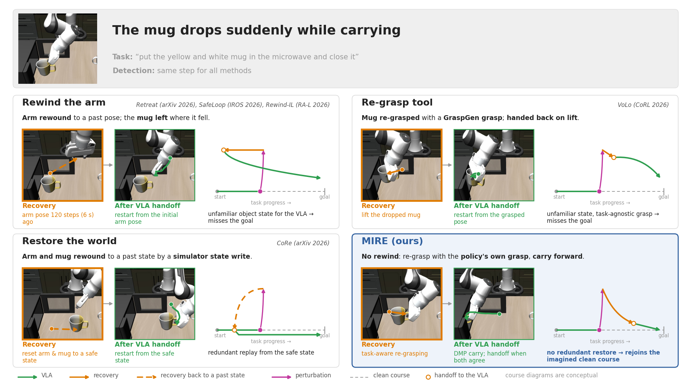<br>
  <em>On the same dropped-mug episode, the baselines go back in time or re-grasp with a task-agnostic grasp, while MIRe moves forward and hands back to the VLA early.</em>
</p>

<p align="center">
  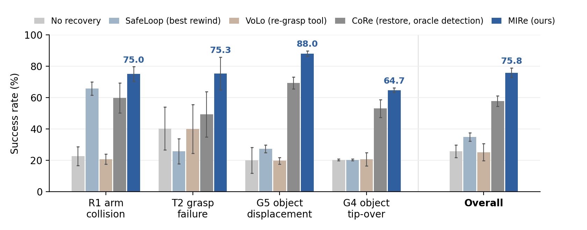<br>
  <em>Success rate (%) per perturbation and overall, mean ± std across the three timings (1,200 episodes per method). MIRe reaches 75.8 overall (R1 75.0, T2 75.3, G5 88.0, G4 64.7), against 57.8 for CoRe with oracle detection, 34.8 for SafeLoop, 25.2 for VoLo, and 25.8 without recovery.</em>
</p>

<div align="center">
<table>
<tr><th></th><th>R1 arm collision</th><th>T2 grasp failure</th><th>G5 object displacement</th><th>G4 object tip-over</th></tr>
<tr><th>early</th><td><a href="assets/demo/libero_10_oft/arm_collision_0.30_task9_init5_seed5.mp4">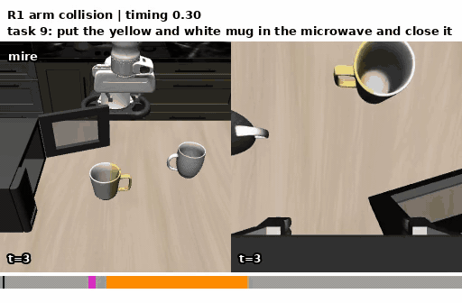</a></td><td><a href="assets/demo/libero_10_oft/grasp_failure_0.30_task9_init5_seed5.mp4">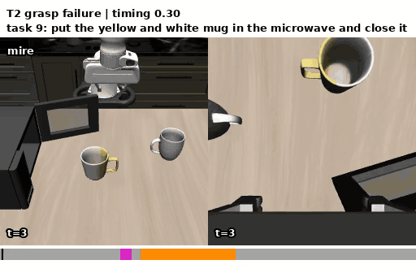</a></td><td><a href="assets/demo/libero_10_oft/object_displace_0.30_task9_init5_seed5.mp4">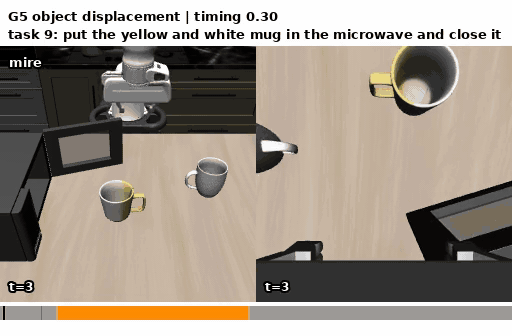</a></td><td><a href="assets/demo/libero_10_oft/object_tip_0.30_task9_init5_seed5.mp4">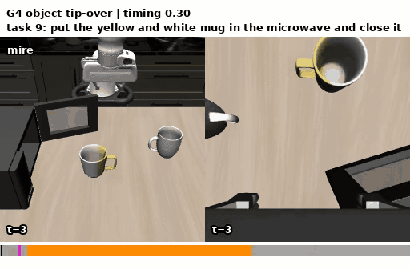</a></td></tr>
<tr><th>mid</th><td><a href="assets/demo/libero_10_oft/arm_collision_0.55_task9_init5_seed5.mp4">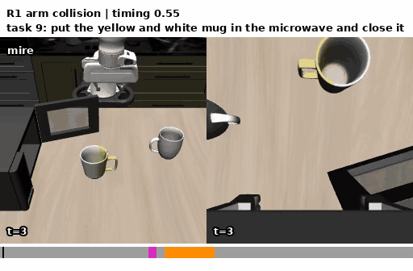</a></td><td><a href="assets/demo/libero_10_oft/grasp_failure_0.55_task9_init5_seed5.mp4">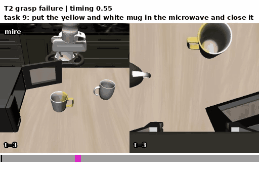</a></td><td><a href="assets/demo/libero_10_oft/object_displace_0.55_task9_init5_seed5.mp4"></a></td><td><a href="assets/demo/libero_10_oft/object_tip_0.55_task9_init5_seed5.mp4"></a></td></tr>
<tr><th>late</th><td><a href="assets/demo/libero_10_oft/arm_collision_0.75_task9_init5_seed5.mp4">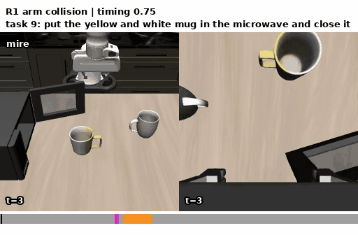</a></td><td><a href="assets/demo/libero_10_oft/grasp_failure_0.75_task9_init5_seed5.mp4">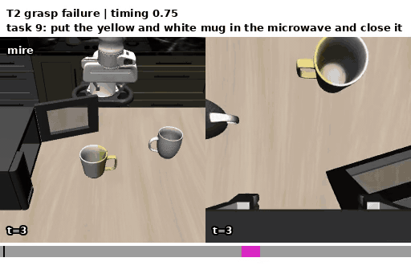</a></td><td><a href="assets/demo/libero_10_oft/object_displace_0.75_task9_init5_seed5.mp4">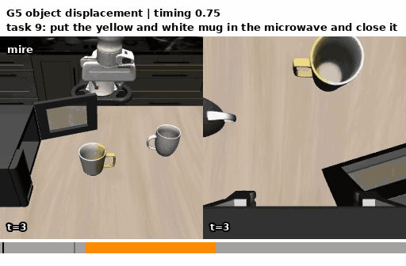</a></td><td><a href="assets/demo/libero_10_oft/object_tip_0.75_task9_init5_seed5.mp4"></a></td></tr>
</table>
<em>MIRe on one episode ("put the yellow and white mug in the microwave and close it") under all twelve perturbations, early / mid / late = timing 0.30 / 0.55 / 0.75: it succeeds in every one. Click a clip for the full video. More in <a href="#62-qualitative-results">6.2</a>.</em>
</div>

## Contents

1. [Installation](#1-installation) ([INSTALL.md](INSTALL.md))
2. [Preprocessing](#2-preprocessing)
3. [Evaluation](#3-evaluation)
4. [Recovery methods](#4-recovery-methods)
5. [Replay](#5-replay)
6. [Results](#6-results) ([RESULTS.md](RESULTS.md))
7. [Limitations](#7-limitations)
8. [References](#8-references)

---

## 1. Installation

See [INSTALL.md](INSTALL.md) for installation, a quick check, and the OpenVLA-OFT evaluation without perturbations (clean evaluation). Run all commands below from the repository root (`VLA_MIRE/`) with the following environment variables, set in every new terminal.

```bash
conda activate openvla-oft
export MUJOCO_GL=egl PYTHONPATH=$PWD/openvla-oft:$PWD
export PYTHONPYCACHEPREFIX=$PWD/.cache/pycache   # keeps __pycache__ out of the submodules
COMMON="--pretrained_checkpoint moojink/openvla-7b-oft-finetuned-libero-10 --task_suite_name libero_10"
```

---

## 2. Preprocessing

These steps run once before the perturbed evaluation. The outputs of 2.1–2.3 (`outputs/calibration/`, `outputs/grasps/`, `outputs/clean/`) are included in the repository and need not be rebuilt. The detector bank of 2.4 is not included because of its size (about 0.9 GB).

### 2.1 Phase calibration

Without perturbations, we run 50 initial states per task and record the first target object touched, the first target object picked (= the perturbation target), the step of each, and the success step. From these records, we compute the phase lengths that set the perturbation timing.

```bash
python src/panda/oft/run_libero_calibration.py $COMMON
cp "$(ls -t outputs/calibration/libero_10/oft/CALIB-libero_10-*.json | head -1)" outputs/calibration/libero_10/oft/CALIB-libero_10.json
```

- **Outputs**
  - Calibration: `outputs/calibration/libero_10/oft/CALIB-libero_10-<time>.json` (phase lengths per task and records per episode)
  - File read by the perturbed evaluation and replay: `outputs/calibration/libero_10/oft/CALIB-libero_10.json` (set with `--calib_path`)
  - Log: `outputs/logs/libero_10/oft/CALIB-libero_10-<time>.txt`
- **Run time**: about 2 hours on one GPU
- **Scope**: all 50 initial states per task are run and recorded with their outcome. The step limit is 600, and failed episodes are also kept in the JSON.
- **Phase lengths**: the minimum over all successful episodes among the 50.
  - `full`: steps until success
  - `pre_grasp`: step at which the target first moves
  - `carry`: steps from lifting the target to releasing it

### 2.2 Grasp candidates (GraspGen)

`volo`, `core`, `core_detect`, and `mire` choose grasps from candidates prepared for each object. The candidates are included in `outputs/grasps/`; GraspGen ([INSTALL.md](INSTALL.md), Section 3) is needed only to rebuild them with the command below.

```bash
python src/panda/generate_grasps.py
```

- **Input point cloud**
  - Objects: the 18 movable objects of LIBERO-10 (each asset once).
  - 2,048 points sampled **only from the outer surface** of the object mesh. The bottom is included, so grasps for tipped-over objects are also generated.
- **Generation**
  - 4 rounds of 500 grasps, 2,000 saved in total; about 3 minutes.
  - Candidates that pass the run-time filter (`conf >= 0.8`, `width <= 0.078`) range from 388 (moka pot) to 1,674 (cream cheese) per object.
- **Output**: `outputs/grasps/libero_10/<object>.npz`, sorted by GraspGen score (high to low):
  - `grasps`: N×4×4, in the object body frame
  - `conf` (score) and `width` (object width measured at the height of the finger pads)
  - `points`, `exterior_share`, `source_task`, `source_object`, `geoms`

### 2.3 Clean rollouts (mire)

MIRe imagines the arm and object trajectories without the perturbation and catches up with them to carry out the task, while handing back to the VLA early. Here we save the rollouts without perturbations; at run time, MIRe uses them as its imagined trajectories.

```bash
python src/panda/oft/collect_clean_trajectories.py $COMMON --num_workers 5
```

### 2.4 Detector bank and calibration (core_detect)

`core_detect` detects perturbations with the CoRe detector. The detector measures how far the action-head features deviate (Mahalanobis distance) from those of successful rollouts without perturbations (the detector bank). We therefore collect the bank and calibrate the trigger threshold in advance.

```bash
# Detector bank: run 50 initial states per task without perturbations and record the action-head features
python src/panda/oft/collect_detector_bank.py $COMMON --num_workers 5
# Calibration: outputs/detector/libero_10/oft/task<id>.npz, index.json, summary.json (CPU)
python src/panda/calibrate_detector.py
```

---

## 3. Evaluation

### 3.1 Full run

For each method, the 12 conditions (4 perturbations × 3 timings) run one after another, and the result tables are updated after each condition. Conditions that already have a finished log (one with a `Total:` line) are skipped, and a failed condition is left as is while the loop moves on. Running the same command again therefore evaluates only the remaining and failed conditions.

```bash
RECS="vanilla replan rehome retreat safeloop rewind_il volo core core_detect mire"   # methods to run
for R in $RECS; do for F in arm_collision grasp_failure object_displace object_tip; do for TM in 0.30 0.55 0.75; do
  grep -qs "Total:" outputs/logs/libero_10/oft/PERTURB-$R-$F-$TM-*--nv10.txt && continue   # skip finished conditions
  python src/panda/oft/run_libero_eval_perturb_parallel.py $COMMON --save_videos none \
    --perturb_family $F --perturb_timing $TM --recovery $R --run_id_note nv10 \
    --num_valid_per_task 10 --num_workers 5   # on failure, move on to the next condition
  python src/summarize_perturb.py --num_splits 1 > /dev/null
done; done; done
```

| Option | Value | Description |
|---|---|---|
| `--perturb_family` | `arm_collision` / `grasp_failure` / `object_displace` / `object_tip` | Perturbation: hit on the arm / gripper forced open while carrying / target moved by 12 cm / target tipped over |
| `--perturb_timing` | `0.30` / `0.55` / `0.75` | Fraction of the calibrated phase length |
| `--recovery` | `vanilla` `replan` `rehome` `retreat` `safeloop` `rewind_il` `volo` `core` `core_detect` `mire` | Recovery method ([4. Recovery methods](#4-recovery-methods)) |
| `--num_valid_per_task` | default 20, 10 in our experiments | Valid episodes collected per task |
| `--num_workers` | default 5 | Simulator processes sharing one model |
| `--max_steps` | default 600 | Step limit per episode |
| `--recovery_delay` | default 8 | Steps from the end of the perturbation to the recovery trigger (oracle trigger; not used by `core_detect`) |
| `--run_id_note` | e.g., `nv10` | Tag in the log names; aggregation (`summarize_perturb.py --tag`) selects runs by this string |

- **Episode selection**: `--num_valid_per_task` valid episodes are collected per task.
  - Only initial states that succeed in the clean evaluation are used, starting from index 0. The perturbation seed of initial state k is k (k+50, k+100, … when 50 are not enough).
  - All methods use the same rule, so the same episodes can be paired across methods.
- **Outputs**
  - Logs: `outputs/logs/libero_10/oft/PERTURB-<recovery>-<perturbation>-<timing>-<time>--<note>.txt` (the last `Total:` line gives the successes in the condition)
  - Per-episode records: the `.jsonl` file with the same name (validity, perturbation parameters, trigger step, success step, and recovery details in `recovery_info`)
  - Actions: `outputs/actions/libero_10/oft/<run_id>/` (for replay)
- **Aggregation**: each condition runs as one log, so the tables are built with `--num_splits 1`. If the tasks were split across two GPUs (`--task_ids 0-4` / `5-9`), each condition has two logs; use `--num_splits 2` (default).

**Run time and notes**
- **Time per method**: about 4–10 hours on one GPU (with two GPUs: `core` 4.2 h, `core_detect` 5.3 h, `mire` 3.7 h).
- **Out of memory**: reduce `--num_workers`.

---

## 4. Recovery methods

| Method | Source | What it does (all but `core_detect` use the oracle trigger: end of the perturbation + 8 steps) |
|---|---|---|
| `vanilla` | – | No recovery (only the trigger step is recorded) |
| `replan` | – | Discards the remaining action chunk and queries again with the same instruction |
| `rehome` | – | Lifts the arm, interpolates the joints back to the initial pose, and queries again |
| `retreat` | [Simple Retreat](https://arxiv.org/abs/2610.06921) (arXiv, uploaded 2026-10-02) | Retreats to the joint pose of 120 steps earlier and hands back after 40 steps |
| `safeloop` | [SafeLoop](https://arxiv.org/abs/2609.26313) (IROS 2026) | Rolls the joints back to a safe waypoint saved every 20 steps |
| `rewind_il` | [Rewind-IL](https://arxiv.org/abs/2604.16683) (RA-L 2026, presented at ICRA 2027) | Returns to the joint pose of the latest subgoal checkpoint |
| `volo` | [VoLo](https://arxiv.org/abs/2606.07723) (CoRL 2026) | Re-grasps the perturbed target with a GraspGen grasp and hands back right away |
| `core` | [CoRe](https://arxiv.org/abs/2608.14822) (arXiv, uploaded 2026-08-14) | Picks a rejoin point with an imagined rollout, physically puts the target back, and hands back. Detection is replaced by an oracle (100% detection) |
| `core_detect` | [CoRe](https://arxiv.org/abs/2608.14822) (arXiv, uploaded 2026-08-14) | CoRe closer to the paper, triggered by its latent Mahalanobis detector. Recovery after the trigger is the same as `core` |
| `mire` | ours | Does not rewind the world; re-grasps with the original grasp, carries with a DMP, and hands back early once the shadow VLA agrees |

Since this repository compares recovery, all baselines use the same oracle trigger instead of their own detectors or VLMs (only `core_detect` uses the original detector). Differences from the original papers are listed per method below.

### rehome
When a failure occurs, the gripper returns to its initial position, the action chunk is cleared, and the policy starts again.
- The arm is first lifted and then interpolated to the initial joint pose, so that it does not hit objects on the way back.
- A held object stays in the gripper on the way back.

### retreat
**Source**: Sheng et al., *Does a Learned Corrector Beat a Simple Retreat? Evidence from a Frozen VLA*, arXiv, uploaded 2026-10-02 · [arXiv:2610.06921](https://arxiv.org/abs/2610.06921) (code to be released)

When a perturbation occurs, the arm retreats to the joint pose of 120 steps earlier and hands back to the VLA after 40 steps.
- A simple recovery that only retreats, with no planner or learning. The paper finds no difference between a learned corrector and this retreat.
- Joint interpolation only, without path planning or lifting.

### safeloop
**Source**: Lou et al., *SafeLoop: Risk-Aware Rollback for Vision-Language-Action Manipulation*, IROS 2026 · [arXiv:2609.26313](https://arxiv.org/abs/2609.26313) · [GitHub](https://github.com/Loule0-0/SafeLoop/tree/release/safeloop)

Rewinds to a safe joint pose saved every 20 steps before the perturbation, then hands back to the VLA.
- The learned risk predictor and decision module of the paper are replaced by an oracle.
  - The state before an injected perturbation is always safe, so the joint pose is saved every 20 steps.
  - The perturbation time is known, so detection is set to 8 steps after the perturbation ends.
- As in the paper, no rollback is done if the arm touches something on the rewind path.

### rewind_il
**Source**: Zheng et al., *Rewind-IL: Online Failure Detection and State Respawning for Imitation Learning*, IEEE RA-L 2026 (presented at ICRA 2027) · [arXiv:2604.16683](https://arxiv.org/abs/2604.16683) · [Project](https://sjay05.github.io/rewind-il)

Returns to the joint pose of the latest subgoal checkpoint (when the target was grasped or a goal condition was met), then hands back to the VLA.
- The VLM-based checkpoint selection and the policy-feature-based recognition of the paper are replaced by BDDL milestones tracked in the simulator.
- If there is no checkpoint to return to, it does nothing.

### volo
**Source**: Chen et al., *VoLo: A Physical Orchestrator for Open-Vocabulary Long-Horizon Manipulation*, CoRL 2026 · [arXiv:2606.07723](https://arxiv.org/abs/2606.07723) · [Project](https://chicychen.github.io/VoLo/) · [GitHub](https://github.com/NVlabs/VoLoAgent)

Re-grasps the perturbed target with a GraspGen grasp and hands back to the VLA right after lifting it.
- Of the paper's tools, only the grasp tool is reproduced. VLM monitoring and tool selection are replaced by the oracle trigger and state rules, and object perception by simulator poses.
- The grasp is the first candidate, in score order, that passes IK and collision checks. How the VLA originally grasped the object is not considered.

### core
**Source**: Zhang et al., *Imagining Recovery: Inference-Time Counterfactual Realignment for Vision-Language-Action Models*, arXiv, uploaded 2026-08-14 · [arXiv:2608.14822](https://arxiv.org/abs/2608.14822) (code not released)

Rolls out the policy in imagination from a reference point before the perturbation to pick a rejoin point, puts the moved target back in place, moves the arm to the rejoin point, and hands back to the policy.
- Detection is the same oracle as for the other baselines (100% detection). The version with the original detector is `core_detect`.
- In LIBERO, the paper restores the world by writing the simulator state directly; we restore it by physical pick-and-place. Restoration can therefore fail. In that case, instead of the paper's request for human help, only the arm is moved to the rejoin point before handing back.
- The imagined rollout uses observations rendered by moving the arm in a separate copy of the simulator, instead of the paper's RGB-D voxel synthesis.

### core_detect
**Source**: the same paper as `core` (CoRe)

CoRe closer to the paper, triggered by its online OOD detector (Mahalanobis distance of the action-head latents). Recovery after the trigger is the same as `core`.
- The detector follows the paper, but uses one query instead of eight because the OFT action head is deterministic.
- There are no false triggers before the perturbation (0/1200), but triggering is late: the median delay from the perturbation to the first trigger is 60–170 steps (9–18 for the oracle). The quarter of episodes with the latest triggers has an 8% success rate, far below `core` on the same episodes (55%).

### mire (ours)

<p align="center">
  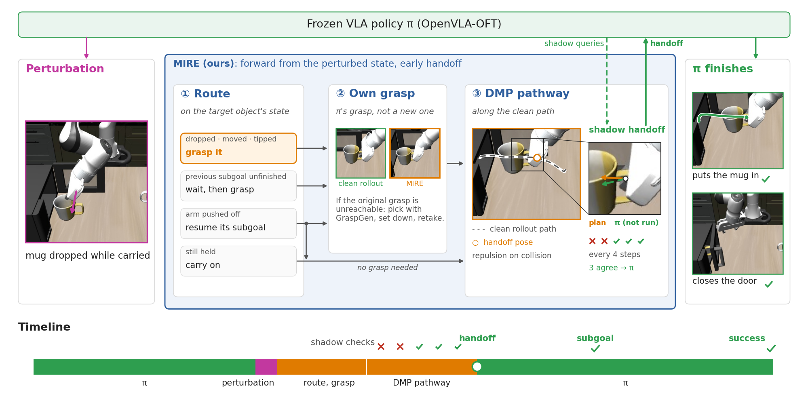<br>
  <em>MIRe routes on the target object's state, retakes it with the policy's own grasp, follows the clean path with a DMP, and hands back once the shadow-queried VLA agrees.</em>
</p>

Does not rewind the world (arm and objects). It re-grasps the target with the grasp the VLA originally used, carries it, and hands back as soon as the VLA can take over.
- **No rewind**: the arm and objects are not rewound to a past state; the current subgoal continues from the perturbed state.
- **Original grasp**: the grasp the VLA made in the clean rollout is reused in the object frame. If that grasp cannot be reached directly, the object is picked with another grasp, set down, and taken again with the original grasp, so that the VLA takes over from a familiar hand pose.
- **DMP carry**: a joint-space DMP follows the shape of the clean carry, with a repulsive term that avoids predicted collisions. Releasing is left to the VLA; the carry stops 40 steps before it.
- **Shadow VLA handoff**: the VLA is queried during the carry, and control is handed back on the spot once its actions agree with the plan three times in a row.
- **Imagined trajectory**: the trajectory without the perturbation is used like the imagined rollout of CoRe. For now, it is replaced by a real rollout run beforehand from the same initial state.

---

## 5. Replay

The perturbed evaluation records the policy actions and fixture positions of every episode, so videos can be made again without the model.

```bash
python src/panda/oft/replay_libero.py --recovery mire --family object_tip --timing 0.55 --task_ids 0-4 --success false
```

Videos are saved in `outputs/videos/libero_10/oft/<run_id>/`.

The qualitative videos of [Section 6.2](#62-qualitative-results) and Section 2 of [RESULTS.md](RESULTS.md) are made the same way: paired episodes are chosen per scenario, and the methods are placed side by side in one video.

```bash
python src/panda/oft/make_qualitative.py --num_workers 8
```

The videos (mp4) and previews (GIF) are saved in `assets/qualitative/libero_10_oft/`, and the lists in Section 6.2 and in Section 2 of RESULTS.md are rewritten.

---

## 6. Results

The failure-stage analysis, additional metrics per method, and all qualitative results per scenario are in [RESULTS.md](RESULTS.md).

### 6.1 Quantitative results

<!-- The tables below are regenerated from the logs by `python src/summarize_perturb.py`. Do not edit them by hand. -->

<!-- RESULTS:nv10 START -->
**Table 1. Success rate per perturbation (%), mean ± sample std across the 3 timings (1,200 episodes per method)**

| Method | R1 arm collision | T2 grasp failure | G5 object displacement | G4 object tip-over | Overall |
|---|---|---|---|---|---|
| *CoRe paper: bare OFT* | *18.7 ± 4.3* | *65.0 ± 9.5* | *13.5 ± 6.4* | *10.3 ± 3.9* | *26.9 ± 1.8* |
| vanilla | 22.7 ± 6.0 | 40.3 ± 13.7 | 20.0 ± 8.2 | 20.3 ± 0.6 | 25.8 ± 4.0 |
| replan | 23.7 ± 5.5 | 39.7 ± 15.1 | 20.3 ± 6.8 | 19.7 ± 0.6 | 25.8 ± 4.4 |
| rehome | 53.7 ± 8.3 | 32.0 ± 13.1 | 27.3 ± 2.3 | 20.7 ± 2.1 | 33.4 ± 2.2 |
| retreat | 38.7 ± 13.1 | 30.0 ± 11.3 | 21.7 ± 2.1 | 21.7 ± 2.5 | 28.0 ± 3.9 |
| safeloop | <ins>65.7 ± 4.2</ins> | 25.7 ± 8.0 | 27.3 ± 2.5 | 20.3 ± 0.6 | 34.8 ± 2.7 |
| rewind_il | 36.0 ± 12.8 | 43.7 ± 14.6 | 17.7 ± 7.2 | 21.0 ± 1.7 | 29.6 ± 4.9 |
| volo | 20.7 ± 3.2 | 40.0 ± 15.6 | 19.7 ± 2.1 | 20.7 ± 4.2 | 25.2 ± 5.4 |
| core | 59.7 ± 9.5 | 49.3 ± 14.4 | <ins>69.3 ± 3.8</ins> | <ins>53.0 ± 5.6</ins> | <ins>57.8 ± 3.3</ins> |
| core_detect | 42.3 ± 10.3 | <ins>53.3 ± 8.5</ins> | 39.0 ± 5.3 | 34.0 ± 3.6 | 42.2 ± 3.5 |
| mire | **75.0 ± 4.6** | **75.3 ± 10.4** | **88.0 ± 1.7** | **64.7 ± 1.5** | **75.8 ± 3.0** |

**Table 2. Success rate per perturbation and timing (%)**

| Method | R1 arm collision<br>0.30 / 0.55 / 0.75 | T2 grasp failure<br>0.30 / 0.55 / 0.75 | G5 object displacement<br>0.30 / 0.55 / 0.75 | G4 object tip-over<br>0.30 / 0.55 / 0.75 |
|---|---|---|---|---|
| *CoRe paper: bare OFT* | *15.5 / 17.0 / 23.5* | *54.5 / 67.5 / 73.0* | *20.5 / 12.0 / 8.0* | *13.5 / 6.0 / 11.5* |
| vanilla | 22 / 17 / 29 | 34 / 31 / 56 | 29 / 18 / 13 | 21 / 20 / 20 |
| replan | 20 / 21 / 30 | 33 / 29 / 57 | 28 / 18 / 15 | 20 / 19 / 20 |
| rehome | 63 / 47 / 51 | 23 / 26 / 47 | 26 / 30 / 26 | 20 / 23 / 19 |
| retreat | 51 / 25 / 40 | 23 / 24 / 43 | 24 / 21 / 20 | 22 / 24 / 19 |
| safeloop | <ins>67</ins> / <ins>61</ins> / <ins>69</ins> | 25 / 18 / 34 | 30 / 27 / 25 | 20 / 21 / 20 |
| rewind_il | 22 / 39 / 47 | 32 / 39 / 60 | 26 / 13 / 14 | 22 / 22 / 19 |
| volo | 23 / 17 / 22 | 32 / 30 / 58 | 18 / 19 / 22 | 16 / 22 / 24 |
| core | 60 / 50 / <ins>69</ins> | <ins>66</ins> / 41 / 41 | <ins>65</ins> / <ins>71</ins> / <ins>72</ins> | <ins>47</ins> / <ins>54</ins> / <ins>58</ins> |
| core_detect | 45 / 31 / 51 | 47 / <ins>50</ins> / <ins>63</ins> | 45 / 35 / 37 | 33 / 38 / 31 |
| mire | **76** / **70** / **79** | **87** / **67** / **72** | **87** / **90** / **87** | **66** / **65** / **63** |

- Progress: 120/120 conditions (`…` = still running)
- Valid episodes per condition: 100 (10 tasks pooled; CoRe paper: 200)
- 95% interval of a per-timing value: about ±8–10 pp at 100 episodes
- The CoRe paper reports CoRe only on π0.5, X-VLA and GR00T N1.7, not on OpenVLA-OFT
<!-- RESULTS:nv10 END -->

### 6.2 Qualitative results

<!-- The video lists (QUALITATIVE_MAIN blocks) are rewritten by `python src/panda/oft/make_qualitative.py` from the main episodes in selection.json. The titles and text are written by hand. -->

Every method replays the same episode (perturbation, timing, initial state and seed). Frames are outlined in magenta during the perturbation, orange during recovery and green after success, and end with the success step or "timeout" (600 steps). The clips loop at 2× speed; click one for the full video.

#### MIRe achieves challenging tasks

All nine other methods fail in these episodes (four of them shown). Instead of going back to a past state, MIRe carries the task forward onto the clean course and hands the VLA a state it can finish from.

<!-- QUALITATIVE_MAIN:nv10:mire_only START -->
**R1 arm collision**

<a href="assets/qualitative/libero_10_oft/readme/mire_only/arm_collision_0.30_task6_init6_seed6.mp4">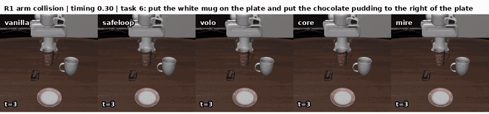</a>

**T2 grasp failure**

<a href="assets/qualitative/libero_10_oft/readme/mire_only/grasp_failure_0.55_task7_init5_seed5.mp4">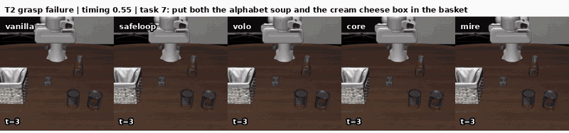</a>

**G5 object displacement**

<a href="assets/qualitative/libero_10_oft/readme/mire_only/object_displace_0.30_task2_init9_seed9.mp4">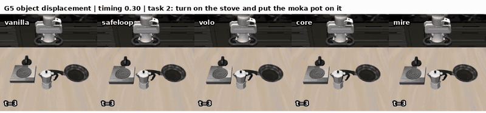</a>

**G4 object tip-over**

<a href="assets/qualitative/libero_10_oft/readme/mire_only/object_tip_0.55_task7_init9_seed9.mp4">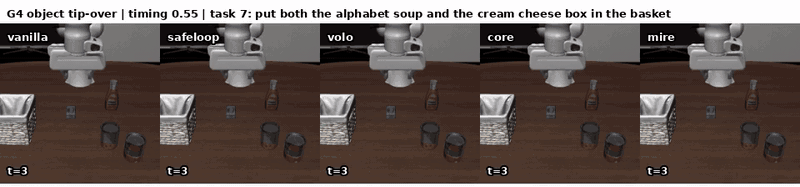</a>
<!-- QUALITATIVE_MAIN:nv10:mire_only END -->

#### MIRe completes tasks faster

Other methods also succeed here, but MIRe finishes at least 50 steps (2.5 s) before the fastest of them: it does not redo the task from a past state, and it hands back as soon as the VLA can continue.

<!-- QUALITATIVE_MAIN:nv10:faster START -->
**R1 arm collision**

<a href="assets/qualitative/libero_10_oft/readme/faster/arm_collision_0.30_task4_init9_seed9.mp4">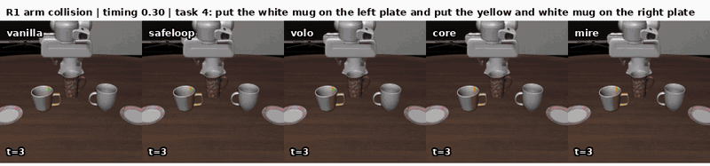</a>

**T2 grasp failure**

<a href="assets/qualitative/libero_10_oft/readme/faster/grasp_failure_0.30_task5_init2_seed2.mp4">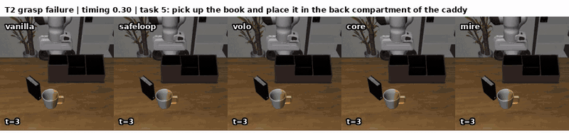</a>

**G5 object displacement**

<a href="assets/qualitative/libero_10_oft/readme/faster/object_displace_0.55_task0_init0_seed0.mp4">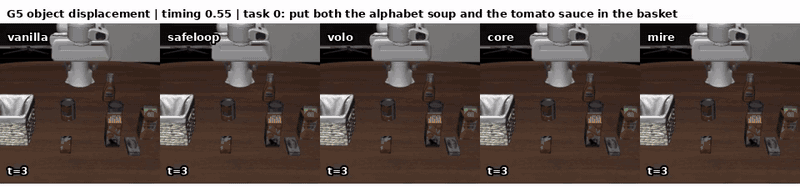</a>

**G4 object tip-over**

<a href="assets/qualitative/libero_10_oft/readme/faster/object_tip_0.55_task2_init2_seed2.mp4">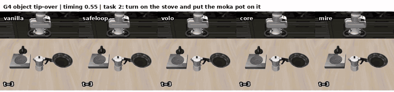</a>
<!-- QUALITATIVE_MAIN:nv10:faster END -->

#### MIRe re-grasps with the task in mind

MIRe retakes the object with the grasp the policy itself used in its clean rollout (setting the object down and retaking it when that grasp cannot be reached directly), so the VLA continues from a grasp it knows. In these episodes VoLo, which grasps with GraspGen, or CoRe fails.

<!-- QUALITATIVE_MAIN:nv10:regrasp START -->
**R1 arm collision**

<a href="assets/qualitative/libero_10_oft/readme/regrasp/arm_collision_0.75_task4_init0_seed0.mp4">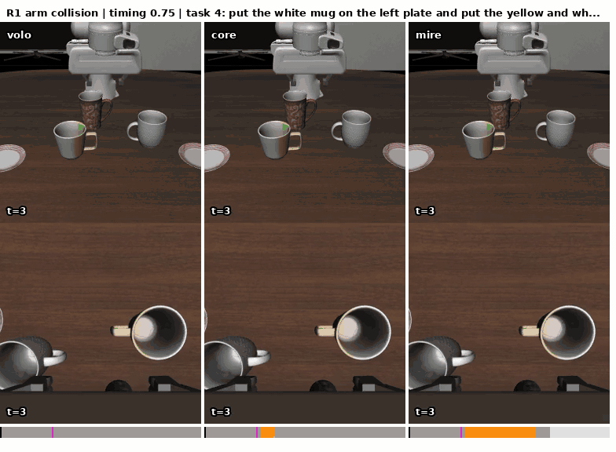</a>

**T2 grasp failure**

<a href="assets/qualitative/libero_10_oft/readme/regrasp/grasp_failure_0.75_task6_init9_seed9.mp4">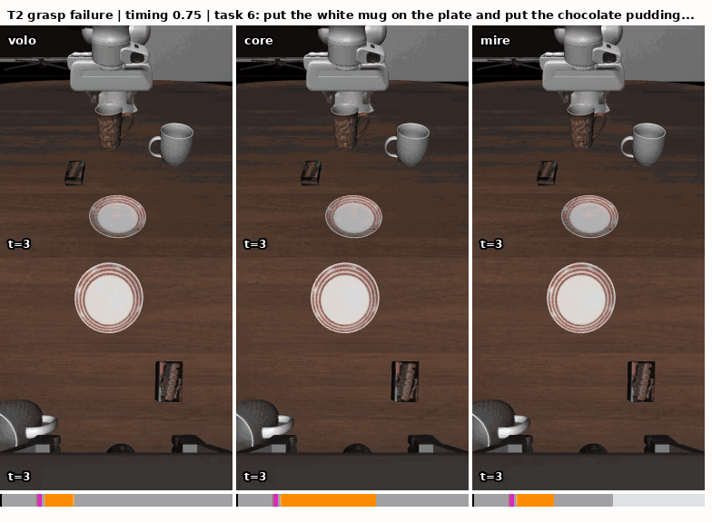</a>

**G5 object displacement**

<a href="assets/qualitative/libero_10_oft/readme/regrasp/object_displace_0.55_task5_init6_seed6.mp4"></a>

**G4 object tip-over**

<a href="assets/qualitative/libero_10_oft/readme/regrasp/object_tip_0.55_task4_init8_seed8.mp4"></a>
<!-- QUALITATIVE_MAIN:nv10:regrasp END -->

#### When MIRe hands off to the VLA

While recovering, MIRe keeps querying the VLA and hands back as soon as its actions agree with the plan three times in a row, instead of carrying out the whole plan. The bar under each video shows who acts: gray for the VLA, magenta for the perturbation, orange for MIRe.

<!-- QUALITATIVE_MAIN:nv10:handoff START -->
<table>
<tr><th>R1 arm collision</th><th>T2 grasp failure</th></tr>
<tr><td><a href="assets/qualitative/libero_10_oft/readme/handoff/arm_collision_0.55_task3_init9_seed9.mp4">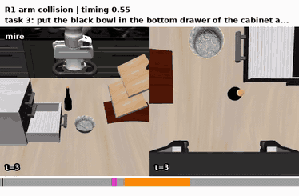</a></td><td><a href="assets/qualitative/libero_10_oft/readme/handoff/grasp_failure_0.55_task6_init7_seed7.mp4">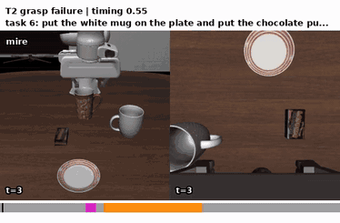</a></td></tr>
<tr><th>G5 object displacement</th><th>G4 object tip-over</th></tr>
<tr><td><a href="assets/qualitative/libero_10_oft/readme/handoff/object_displace_0.55_task5_init9_seed9.mp4">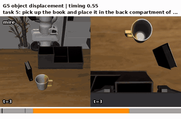</a></td><td><a href="assets/qualitative/libero_10_oft/readme/handoff/object_tip_0.55_task6_init6_seed6.mp4">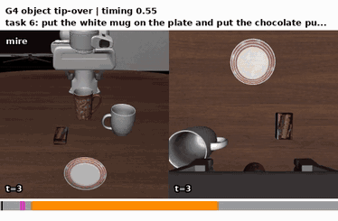</a></td></tr>
</table>
<!-- QUALITATIVE_MAIN:nv10:handoff END -->

#### Failure cases

One episode per perturbation in which MIRe fails, with the stage at which it failed under each video.

<!-- QUALITATIVE_MAIN:nv10:limits START -->
<table>
<tr><th>R1 arm collision</th><th>T2 grasp failure</th><th>G5 object displacement</th><th>G4 object tip-over</th></tr>
<tr><td><a href="assets/qualitative/libero_10_oft/readme/limits/arm_collision_0.55_task6_init4_seed4.mp4">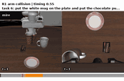</a><br>recovery exec. failed</td><td><a href="assets/qualitative/libero_10_oft/readme/limits/grasp_failure_0.55_task1_init3_seed3.mp4">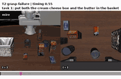</a><br>recovery infeasible</td><td><a href="assets/qualitative/libero_10_oft/readme/limits/object_displace_0.30_task0_init5_seed5.mp4">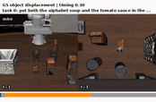</a><br>policy failed after recovery</td><td><a href="assets/qualitative/libero_10_oft/readme/limits/object_tip_0.30_task4_init6_seed6.mp4">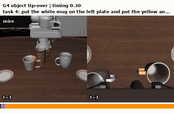</a><br>no intervention</td></tr>
</table>
<!-- QUALITATIVE_MAIN:nv10:limits END -->

---

## 7. Limitations

- **Privileged clean rollout**: MIRe takes its grasp, carry path, and handoff pose from a clean rollout run beforehand from the same initial state, as a stand-in for an imagined trajectory. This is not available in deployment.
- **Oracle detection and perception**: all methods except `core_detect` are triggered by an oracle (end of the perturbation + 8 steps), and the recoveries read object poses and BDDL goal conditions from the simulator.
- **Unofficial baselines**: the baselines are our reimplementations. Parts that the papers learn or obtain from VLMs are replaced by oracles ([Section 4](#4-recovery-methods)), and `core` restores the world by pick-and-place instead of writing the simulator state.
- **Scope**: one policy (OpenVLA-OFT), one suite (LIBERO-10), simulation only, and the four perturbations of the CoRe protocol.
- **Planning time**: recovery planning runs while the simulation is paused, so its wall-clock time is not part of the 600-step limit.

---

## 8. References

Work used to build this repository. For papers only on arXiv, the upload date of v1 is given.

| Name | Paper | Venue | Links | GitHub |
|---|---|---|---|---|
| OpenVLA | Kim et al., *OpenVLA: An Open-Source Vision-Language-Action Model* | CoRL 2024 | [arXiv:2406.09246](https://arxiv.org/abs/2406.09246) | [openvla/openvla](https://github.com/openvla/openvla) |
| OpenVLA-OFT | Kim et al., *Fine-Tuning Vision-Language-Action Models: Optimizing Speed and Success* | RSS 2025 | [arXiv:2502.19645](https://arxiv.org/abs/2502.19645) · [checkpoint](https://huggingface.co/moojink/openvla-7b-oft-finetuned-libero-10) | [moojink/openvla-oft](https://github.com/moojink/openvla-oft) |
| LIBERO | Liu et al., *LIBERO: Benchmarking Knowledge Transfer for Lifelong Robot Learning* | NeurIPS 2023 (Datasets and Benchmarks) | [arXiv:2306.03310](https://arxiv.org/abs/2306.03310) | [Lifelong-Robot-Learning/LIBERO](https://github.com/Lifelong-Robot-Learning/LIBERO) |
| robosuite | Zhu et al., *robosuite: A Modular Simulation Framework and Benchmark for Robot Learning* | arXiv, uploaded 2020-09-25 | [arXiv:2009.12293](https://arxiv.org/abs/2009.12293) | [ARISE-Initiative/robosuite](https://github.com/ARISE-Initiative/robosuite) |
| MuJoCo | Todorov et al., *MuJoCo: A physics engine for model-based control* | IROS 2012 | [DOI](https://doi.org/10.1109/IROS.2012.6386109) | [google-deepmind/mujoco](https://github.com/google-deepmind/mujoco) |
| GraspGen | Murali et al., *GraspGen: A Diffusion-based Framework for 6-DOF Grasping with On-Generator Training* | ICRA 2026 | [arXiv:2507.13097](https://arxiv.org/abs/2507.13097) · [models](https://huggingface.co/adithyamurali/GraspGenModels) | [NVlabs/GraspGen](https://github.com/NVlabs/GraspGen) |
| Simple Retreat (`retreat`) | Sheng et al., *Does a Learned Corrector Beat a Simple Retreat? Evidence from a Frozen VLA* | arXiv, uploaded 2026-10-02 | [arXiv:2610.06921](https://arxiv.org/abs/2610.06921) | – (to be released) |
| SafeLoop (`safeloop`) | Lou et al., *SafeLoop: Risk-Aware Rollback for Vision-Language-Action Manipulation* | IROS 2026 | [arXiv:2609.26313](https://arxiv.org/abs/2609.26313) | [Loule0-0/SafeLoop](https://github.com/Loule0-0/SafeLoop/tree/release/safeloop) |
| Rewind-IL (`rewind_il`) | Zheng et al., *Rewind-IL: Online Failure Detection and State Respawning for Imitation Learning* | IEEE RA-L 2026 (presented at ICRA 2027) | [arXiv:2604.16683](https://arxiv.org/abs/2604.16683) · [project](https://sjay05.github.io/rewind-il) | – (to be released) |
| VoLo (`volo`) | Chen et al., *VoLo: A Physical Orchestrator for Open-Vocabulary Long-Horizon Manipulation* | CoRL 2026 | [arXiv:2606.07723](https://arxiv.org/abs/2606.07723) · [project](https://chicychen.github.io/VoLo/) | [NVlabs/VoLoAgent](https://github.com/NVlabs/VoLoAgent) |
| CoRe (`core`, `core_detect`) | Zhang et al., *Imagining Recovery: Inference-Time Counterfactual Realignment for Vision-Language-Action Models* | arXiv, uploaded 2026-08-14 | [arXiv:2608.14822](https://arxiv.org/abs/2608.14822) | – (not released) |
| DMP | Ijspeert et al., *Dynamical Movement Primitives: Learning Attractor Models for Motor Behaviors* | Neural Computation 2013 | [DOI](https://doi.org/10.1162/NECO_a_00393) | – |
| DMP generalization (`mire` carry) | Pastor et al., *Learning and generalization of motor skills by learning from demonstration* | ICRA 2009 | [DOI](https://doi.org/10.1109/ROBOT.2009.5152385) | – |
| DMP obstacle avoidance (`mire` carry) | Hoffmann et al., *Biologically-inspired dynamical systems for movement generation: Automatic real-time goal adaptation and obstacle avoidance* | ICRA 2009 | [DOI](https://doi.org/10.1109/ROBOT.2009.5152423) | – |
| Minimum-jerk trajectory (`mire` set-down carry) | Flash and Hogan, *The coordination of arm movements: an experimentally confirmed mathematical model* | Journal of Neuroscience 1985 | [DOI](https://doi.org/10.1523/JNEUROSCI.05-07-01688.1985) | – |
