# Detailed results

Supplementary material for Section 1 (Results) of the [README](README.md).

## 1. Success per timing, failure stages, and per-method statistics

<!-- The figure and tables below are regenerated from the logs by `python src/summarize_perturb.py`. Do not edit them by hand. -->

<!-- DETAILS:nv10 START -->
**Table S1. Success rate per perturbation and timing (%)**

| Method | R1 arm collision 0.30 / 0.55 / 0.75 | T2 grasp failure 0.30 / 0.55 / 0.75 | G5 object displacement 0.30 / 0.55 / 0.75 | G4 object tip-over 0.30 / 0.55 / 0.75 |
|---|---|---|---|---|
| *CoRe paper: bare OFT* | *15.5 / 17.0 / 23.5* | *54.5 / 67.5 / 73.0* | *20.5 / 12.0 / 8.0* | *13.5 / 6.0 / 11.5* |
| vanilla | 22 / 17 / 29 | 34 / 31 / 56 | 29 / 18 / 13 | 21 / 20 / 20 |
| replan | 20 / 21 / 30 | 33 / 29 / 57 | 28 / 18 / 15 | 20 / 19 / 20 |
| rehome | 63 / 47 / 51 | 23 / 26 / 47 | 26 / 30 / 26 | 20 / 23 / 19 |
| retreat | 51 / 25 / 40 | 23 / 24 / 43 | 24 / 21 / 20 | 22 / 24 / 19 |
| safeloop | <ins>67</ins> / <ins>61</ins> / <ins>69</ins> | 25 / 18 / 34 | 30 / 27 / 25 | 20 / 21 / 20 |
| rewind_il | 22 / 39 / 47 | 32 / 39 / 60 | 26 / 13 / 14 | 22 / 22 / 19 |
| volo | 23 / 17 / 22 | 32 / 30 / 58 | 18 / 19 / 22 | 16 / 22 / 24 |
| core | 60 / 50 / <ins>69</ins> | <ins>66</ins> / 41 / 41 | <ins>65</ins> / <ins>71</ins> / <ins>72</ins> | <ins>47</ins> / <ins>54</ins> / <ins>58</ins> |
| core_detect | 45 / 31 / 51 | 47 / <ins>50</ins> / <ins>63</ins> | 45 / 35 / 37 | 33 / 38 / 31 |
| mire | **76** / **70** / **79** | **87** / **67** / **72** | **87** / **90** / **87** | **66** / **65** / **63** |

- 95% interval of a per-timing value: about ±8–10 pp at 100 episodes

**Figure S1. Failed episodes by recovery stage**

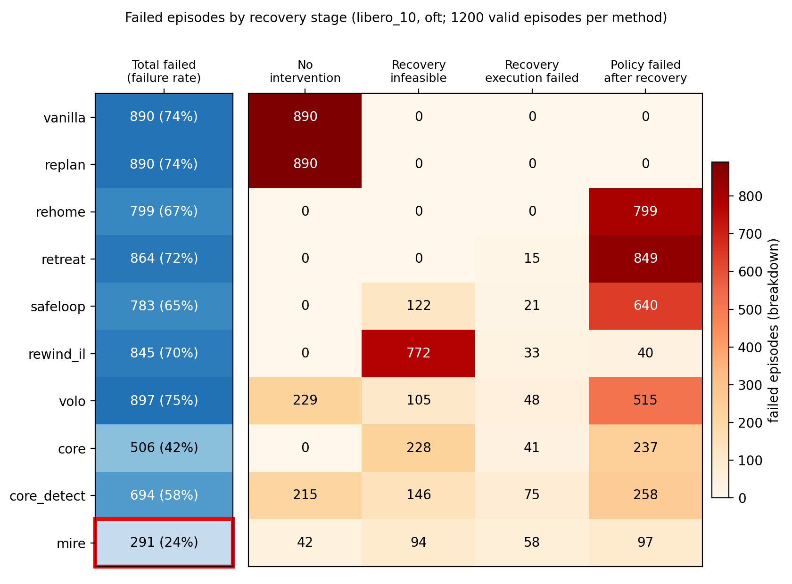

- Failed episodes per method, split by the stage where the recovery fell short
- Stages come from each episode's `recovery_info`, not from the physical outcome
- Left column: total failures and failure rate (own blue scale); red box = lowest failure rate
- Right columns: one color scale for all cells; lighter = fewer failures

| Stage | Meaning |
|---|---|
| No intervention | Did not act: vanilla, replan; volo / mire judged no recovery needed (or mire was still waiting); core_detect never fired after the perturbation |
| Recovery infeasible | No plan, waypoint or checkpoint; path rejected; intervention request; restoration cap; mire gave up |
| Recovery execution failed | Acted but fell short: not arrived, grasp missed, object not restored (> 3 cm), mire handed back early |
| Policy failed after recovery | Recovery finished, but the policy did not complete the task within 600 steps |

**Table S2. rehome statistics (valid episodes, 3 timings pooled)**

| Perturbation | Episodes | Moved holding the object | Arrived | Mean steps (lift + joint) | Contact besides the held object | Cut off by the episode end |
|---|---|---|---|---|---|---|
| R1 arm collision | 300 | 40% | 100% | 21 + 40 | 7% | 0% |
| T2 grasp failure | 294 | 4% | 100% | 11 + 26 | 1% | 0% |
| G5 object displacement | 300 | 0% | 100% | 11 + 18 | 2% | 0% |
| G4 object tip-over | 300 | 0% | 100% | 12 + 19 | 1% | 0% |

**Table S3. Rewind baselines statistics (valid episodes, 3 timings pooled)**

| Method | Perturbation | Episodes | Rewound | Rewind distance (steps) | Intervention steps | Arrived | Contact besides the held object | Cut off by the episode end | Notes |
|---|---|---|---|---|---|---|---|---|---|
| retreat | R1 arm collision | 300 | 100% | 105 | 40 | 94% | 19% | 0% | clamped to the start pose 37% |
| retreat | T2 grasp failure | 292 | 100% | 112 | 40 | 93% | 5% | 5% | clamped to the start pose 44% |
| retreat | G5 object displacement | 300 | 100% | 45 | 40 | 100% | 4% | 0% | clamped to the start pose 97% |
| retreat | G4 object tip-over | 300 | 100% | 48 | 40 | 99% | 5% | 0% | clamped to the start pose 97% |
| safeloop | R1 arm collision | 300 | 86% | 42 | 38 | 95% | 25% | 0% | no saved waypoint 0%, path rejected (collision) 14% |
| safeloop | T2 grasp failure | 292 | 100% | 47 | 19 | 97% | 12% | 1% | no saved waypoint 0%, path rejected (collision) 0% |
| safeloop | G5 object displacement | 300 | 80% | 25 | 20 | 96% | 10% | 0% | no saved waypoint 20%, path rejected (collision) 0% |
| safeloop | G4 object tip-over | 300 | 80% | 28 | 21 | 96% | 11% | 0% | no saved waypoint 20%, path rejected (collision) 0% |
| rewind_il | R1 arm collision | 300 | 41% | 55 | 54 | 76% | 58% | 0% | no checkpoint 59%, target grasp 42% / subgoal 58% |
| rewind_il | T2 grasp failure | 294 | 11% | 94 | 52 | 39% | 39% | 36% | no checkpoint 89%, target grasp 42% / subgoal 58% |
| rewind_il | G5 object displacement | 300 | 3% | 39 | 120 | 0% | 100% | 0% | no checkpoint 97%, target grasp 0% / subgoal 100% |
| rewind_il | G4 object tip-over | 300 | 3% | 42 | 120 | 0% | 100% | 0% | no checkpoint 97%, target grasp 0% / subgoal 100% |

- Rewound: share of episodes in which the arm moved; the other columns are over those episodes
- Rewind distance: steps from the trigger back to the target pose
- Contact: anything the robot touched while rewinding, except what it held
- retreat hands back after 40 steps, arrived or not

**Table S4. volo statistics (valid episodes, 3 timings pooled)**

| Perturbation | Episodes | Grasp chosen | No solution → VLA | Continue reason (holding / goal met / not disturbed) | Grasped and lifted | Median planning time | Intervention steps | Contact besides the target |
|---|---|---|---|---|---|---|---|---|
| R1 arm collision | 300 | 8% | 2% | 43% / 34% / 23% | 52% | 7.3s | 90 | 8% |
| T2 grasp failure | 291 | 63% | 5% | 15% / 84% / 1% | 86% | 1.0s | 78 | 0% |
| G5 object displacement | 300 | 94% | 6% | - | 99% | 0.6s | 78 | 0% |
| G4 object tip-over | 300 | 76% | 24% | - | 97% | 13.8s | 76 | 3% |

- Grasp chosen, no solution: over the triggered episodes
- Continue reason: over the continues that were not for lack of a solution
- Grasped and lifted, intervention steps, contact: over the executed grasps
- Planning time: wall clock, with the simulation paused

**Table S5. core statistics (valid episodes, 3 timings pooled)**

| Perturbation | Episodes | Rewind distance (steps) | Imagined rollout steps (proximity / cap / IK failure) | Restoration needed | Restored | Infeasible (intervention request) | Intervention steps | Timeout | Success | Success (intervention request = failure) |
|---|---|---|---|---|---|---|---|---|---|---|
| R1 arm collision | 300 | 57 | 5.0 (100% / 0% / 0%) | 64% | 60% | 40% | 119 | 40% | 59.7 | 52.7 |
| T2 grasp failure | 294 | 81 | 0.0 (100% / 0% / 0%) | 99% | 61% | 31% | 170 | 52% | 48.3 | 40.1 |
| G5 object displacement | 300 | 10 | 17.8 (100% / 0% / 0%) | 100% | 90% | 5% | 237 | 31% | 69.3 | 68.7 |
| G4 object tip-over | 300 | 13 | 17.7 (100% / 0% / 0%) | 100% | 51% | 48% | 133 | 47% | 53.0 | 35.7 |

- Restoration: pick the target and place it back (the perturbations move only the target)
- Restored: within 3 cm after placing, one retry
- Infeasible: no grasp fits both pick and place (the paper's intervention request); handed to the policy as is
- Intervention steps: pick, carry, place and rejoin
- Timeout: failures that hit the 600-step limit
- Last column: intervention requests counted as failures, as in the paper

**Table S6. core_detect statistics (valid episodes, 3 timings pooled)**

| Perturbation | Episodes | False trigger before the perturbation | Triggered after | Not triggered after (of which success) | Median perturbation→trigger steps (oracle) | Recoveries | Restoration needed | Restored | Intervention request | Restoration cap | Timeout | Success | Success (intervention request = failure) |
|---|---|---|---|---|---|---|---|---|---|---|---|---|---|
| R1 arm collision | 300 | 0% | 81% | 19% (38%) | 60 (13) | 0.97 | 170/291 | 38% | 52% | 3% | 58% | 42.3 | 35.0 |
| T2 grasp failure | 300 | 0% | 42% | 58% (68%) | 100 (18) | 0.53 | 130/159 | 43% | 41% | 4% | 47% | 53.3 | 52.3 |
| G5 object displacement | 300 | 0% | 65% | 35% (35%) | 167 (9) | 0.73 | 201/219 | 66% | 17% | 3% | 61% | 39.0 | 38.0 |
| G4 object tip-over | 300 | 0% | 61% | 39% (52%) | 170 (12) | 0.91 | 204/272 | 29% | 50% | 10% | 66% | 34.0 | 32.7 |

- Trigger: CoRe's own detector instead of the oracle; several recoveries per episode, one restoration at most
- False trigger before: fired at least once before the perturbation
- Not triggered after: never fired after the perturbation
- Perturbation→trigger: to the first trigger after it; the oracle's value in parentheses
- Recoveries: mean per episode
- Restoration columns: per recovery (needed / all recoveries); success: per episode

**Table S7. mire statistics (valid episodes, 3 timings pooled)**

| Perturbation | Episodes | Route: none / carry / grasp / resume subgoal / gave up | Grasp: own / set down and retaken / other (success of each) | Handoff: agreement / 40 steps before the goal / goal unreachable / grasp missed | Intervention steps (agreement handoffs) | Success after an agreement handoff | Timeout | Success |
|---|---|---|---|---|---|---|---|---|
| R1 arm collision | 300 | 10% / 41% / 43% / 3% / 2% | 78% (90%) / 17% (27%) / 5% (57%) | 56% / 24% / 16% / 3% | 96 (82) | 90% | 25% | 75.0 |
| T2 grasp failure | 293 | 27% / 6% / 58% / 0% / 10% | 65% (91%) / 17% (41%) / 18% (84%) | 18% / 70% / 4% / 8% | 133 (196) | 71% | 25% | 74.7 |
| G5 object displacement | 300 | 0% / 0% / 98% / 0% / 2% | 81% (90%) / 12% (83%) / 7% (86%) | 43% / 50% / 4% / 3% | 130 (152) | 94% | 12% | 88.0 |
| G4 object tip-over | 300 | 0% / 0% / 80% / 0% / 20% | 16% (100%) / 46% (74%) / 38% (80%) | 63% / 30% / 7% / 0% | 220 (215) | 81% | 35% | 64.7 |

- Route (state at the trigger)
  - held → carry; disturbed → grasp, then carry
  - untouched but the arm > 8 cm off the clean rollout → resume the subgoal
  - goal met or arm on its path → none; no feasible grasp → gave up
- Grasp (first grasp on the grasp route; success of each in parentheses)
  - own: the policy's grasp in the clean rollout, or a GraspGen candidate within 10° and 2 cm of it
  - set down and retaken: taken another way, set down, retaken with the own grasp
  - other: GraspGen's best
- Handoff (episodes with an intervention)
  - agreement: the shadow policy matched the plan on 3 checks in a row
  - 40 steps before the goal: reached the clean pose 40 steps before the release
  - goal unreachable, grasp missed: handed back early
- Intervention steps: from the trigger to the handoff
<!-- DETAILS:nv10 END -->

## 2. Qualitative results

Each video replays the same episode (same perturbation, timing, initial state, and seed) for every method from the recorded actions. Frames are outlined in magenta during the perturbation and in orange during recovery, have no outline while the VLA acts, and turn green after success. The banner at the end shows the success step or a timeout (600-step limit); only the limitations (2.4) show the failure stage (Figure S1). The failure stage of each method is in the table under each video. In videos with the wrist camera, the bar at the bottom shows who acts over the whole episode (gray: VLA, magenta: perturbation, orange: recovery), and the black line marks the current step. Click a looping preview (GIF, 2× speed) to open the full video (mp4).

### 2.1 Only mire succeeds

<!-- QUALITATIVE:nv10:mire_only START -->
- mire alone succeeds in 73 of the 1182 paired episodes.

**R1 arm collision, task 6**: put the white mug on the plate and put the chocolate pudding to the right of the plate (timing 0.30, initial state 6, seed 6)

<a href="assets/qualitative/libero_10_oft/results/mire_only/arm_collision_0.30_task6_init6_seed6.mp4">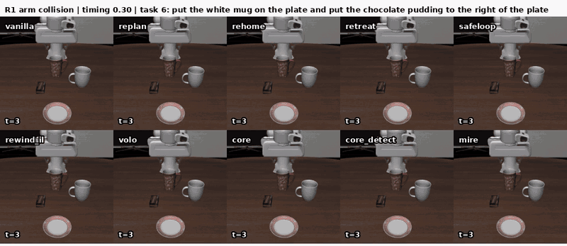</a>

| vanilla | replan | rehome | retreat | safeloop | rewind_il | volo | core | core_detect | mire |
|---|---|---|---|---|---|---|---|---|---|
| ✗ no intervention | ✗ no intervention | ✗ policy failed after recovery | ✗ policy failed after recovery | ✗ policy failed after recovery | ✗ recovery infeasible | ✗ no intervention | ✗ recovery infeasible | ✗ policy failed after recovery | ✓ success t=271 |

**R1 arm collision, task 4**: put the white mug on the left plate and put the yellow and white mug on the right plate (timing 0.30, initial state 3, seed 3)

<a href="assets/qualitative/libero_10_oft/results/mire_only/arm_collision_0.30_task4_init3_seed3.mp4">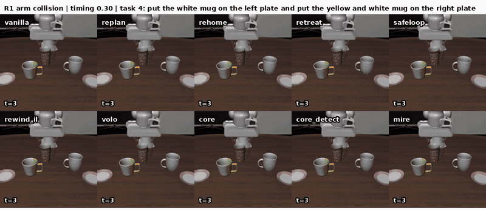</a>

| vanilla | replan | rehome | retreat | safeloop | rewind_il | volo | core | core_detect | mire |
|---|---|---|---|---|---|---|---|---|---|
| ✗ no intervention | ✗ no intervention | ✗ policy failed after recovery | ✗ policy failed after recovery | ✗ policy failed after recovery | ✗ recovery infeasible | ✗ no intervention | ✗ policy failed after recovery | ✗ policy failed after recovery | ✓ success t=296 |

**R1 arm collision, task 8**: put both moka pots on the stove (timing 0.55, initial state 3, seed 3)

<a href="assets/qualitative/libero_10_oft/results/mire_only/arm_collision_0.55_task8_init3_seed3.mp4">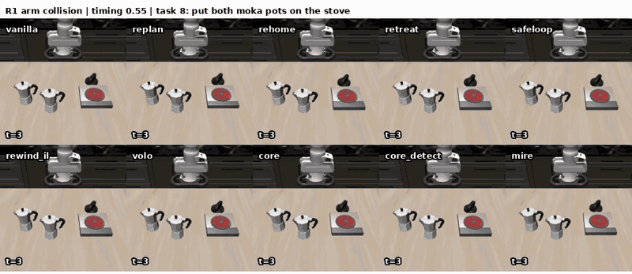</a>

| vanilla | replan | rehome | retreat | safeloop | rewind_il | volo | core | core_detect | mire |
|---|---|---|---|---|---|---|---|---|---|
| ✗ no intervention | ✗ no intervention | ✗ policy failed after recovery | ✗ policy failed after recovery | ✗ policy failed after recovery | ✗ recovery infeasible | ✗ recovery infeasible | ✗ recovery infeasible | ✗ policy failed after recovery | ✓ success t=494 |

**R1 arm collision, task 6**: put the white mug on the plate and put the chocolate pudding to the right of the plate (timing 0.30, initial state 0, seed 0)

<a href="assets/qualitative/libero_10_oft/results/mire_only/arm_collision_0.30_task6_init0_seed0.mp4">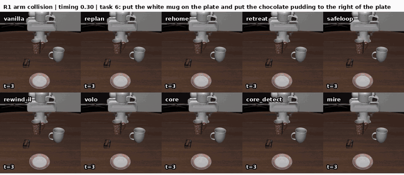</a>

| vanilla | replan | rehome | retreat | safeloop | rewind_il | volo | core | core_detect | mire |
|---|---|---|---|---|---|---|---|---|---|
| ✗ no intervention | ✗ no intervention | ✗ policy failed after recovery | ✗ policy failed after recovery | ✗ policy failed after recovery | ✗ recovery infeasible | ✗ no intervention | ✗ recovery infeasible | ✗ no intervention | ✓ success t=308 |

**R1 arm collision, task 4**: put the white mug on the left plate and put the yellow and white mug on the right plate (timing 0.75, initial state 2, seed 2)

<a href="assets/qualitative/libero_10_oft/results/mire_only/arm_collision_0.75_task4_init2_seed2.mp4">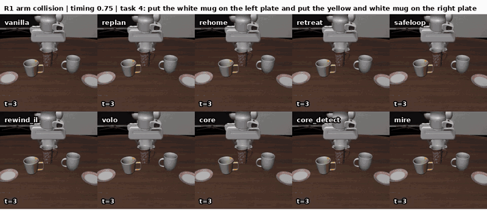</a>

| vanilla | replan | rehome | retreat | safeloop | rewind_il | volo | core | core_detect | mire |
|---|---|---|---|---|---|---|---|---|---|
| ✗ no intervention | ✗ no intervention | ✗ policy failed after recovery | ✗ policy failed after recovery | ✗ policy failed after recovery | ✗ recovery exec. failed | ✗ no intervention | ✗ policy failed after recovery | ✗ policy failed after recovery | ✓ success t=542 |

**T2 grasp failure, task 7**: put both the alphabet soup and the cream cheese box in the basket (timing 0.55, initial state 5, seed 5)

<a href="assets/qualitative/libero_10_oft/results/mire_only/grasp_failure_0.55_task7_init5_seed5.mp4">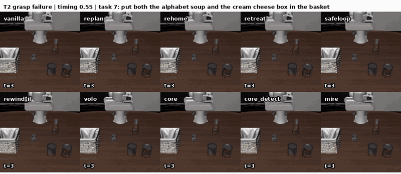</a>

| vanilla | replan | rehome | retreat | safeloop | rewind_il | volo | core | core_detect | mire |
|---|---|---|---|---|---|---|---|---|---|
| ✗ no intervention | ✗ no intervention | ✗ policy failed after recovery | ✗ policy failed after recovery | ✗ policy failed after recovery | ✗ recovery infeasible | ✗ recovery exec. failed | ✗ policy failed after recovery | ✗ no intervention | ✓ success t=462 |

**T2 grasp failure, task 4**: put the white mug on the left plate and put the yellow and white mug on the right plate (timing 0.55, initial state 5, seed 5)

<a href="assets/qualitative/libero_10_oft/results/mire_only/grasp_failure_0.55_task4_init5_seed5.mp4">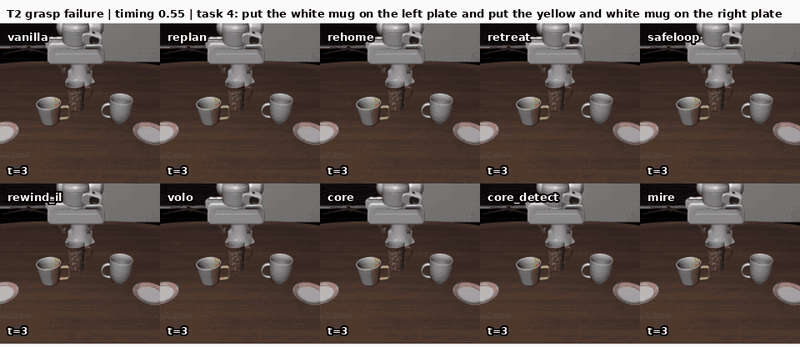</a>

| vanilla | replan | rehome | retreat | safeloop | rewind_il | volo | core | core_detect | mire |
|---|---|---|---|---|---|---|---|---|---|
| ✗ no intervention | ✗ no intervention | ✗ policy failed after recovery | ✗ policy failed after recovery | ✗ policy failed after recovery | ✗ recovery infeasible | ✗ policy failed after recovery | ✗ policy failed after recovery | ✗ policy failed after recovery | ✓ success t=358 |

**T2 grasp failure, task 0**: put both the alphabet soup and the tomato sauce in the basket (timing 0.75, initial state 1, seed 1)

<a href="assets/qualitative/libero_10_oft/results/mire_only/grasp_failure_0.75_task0_init1_seed1.mp4">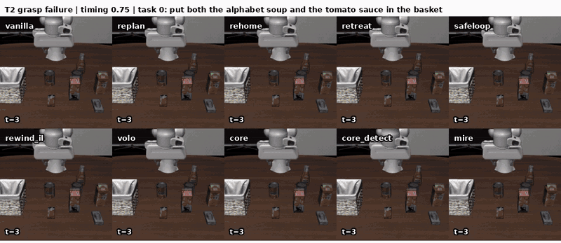</a>

| vanilla | replan | rehome | retreat | safeloop | rewind_il | volo | core | core_detect | mire |
|---|---|---|---|---|---|---|---|---|---|
| ✗ no intervention | ✗ no intervention | ✗ policy failed after recovery | ✗ policy failed after recovery | ✗ policy failed after recovery | ✗ recovery infeasible | ✗ policy failed after recovery | ✗ recovery infeasible | ✗ policy failed after recovery | ✓ success t=450 |

**T2 grasp failure, task 8**: put both moka pots on the stove (timing 0.30, initial state 3, seed 3)

<a href="assets/qualitative/libero_10_oft/results/mire_only/grasp_failure_0.30_task8_init3_seed3.mp4">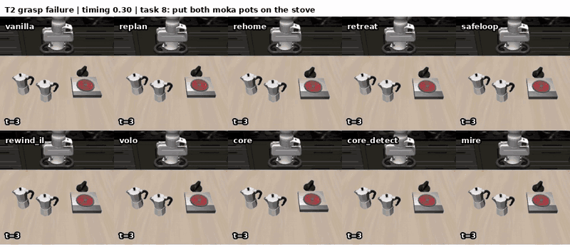</a>

| vanilla | replan | rehome | retreat | safeloop | rewind_il | volo | core | core_detect | mire |
|---|---|---|---|---|---|---|---|---|---|
| ✗ no intervention | ✗ no intervention | ✗ policy failed after recovery | ✗ policy failed after recovery | ✗ recovery exec. failed | ✗ recovery infeasible | ✗ policy failed after recovery | ✗ recovery exec. failed | ✗ no intervention | ✓ success t=479 |

**T2 grasp failure, task 9**: put the yellow and white mug in the microwave and close it (timing 0.30, initial state 5, seed 5)

<a href="assets/qualitative/libero_10_oft/results/mire_only/grasp_failure_0.30_task9_init5_seed5.mp4">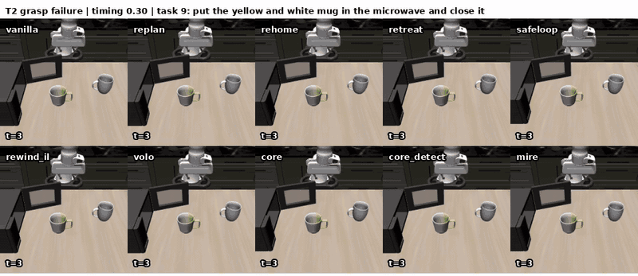</a>

| vanilla | replan | rehome | retreat | safeloop | rewind_il | volo | core | core_detect | mire |
|---|---|---|---|---|---|---|---|---|---|
| ✗ no intervention | ✗ no intervention | ✗ policy failed after recovery | ✗ policy failed after recovery | ✗ policy failed after recovery | ✗ recovery infeasible | ✗ policy failed after recovery | ✗ policy failed after recovery | ✗ no intervention | ✓ success t=359 |

**G5 object displacement, task 2**: turn on the stove and put the moka pot on it (timing 0.30, initial state 9, seed 9)

<a href="assets/qualitative/libero_10_oft/results/mire_only/object_displace_0.30_task2_init9_seed9.mp4">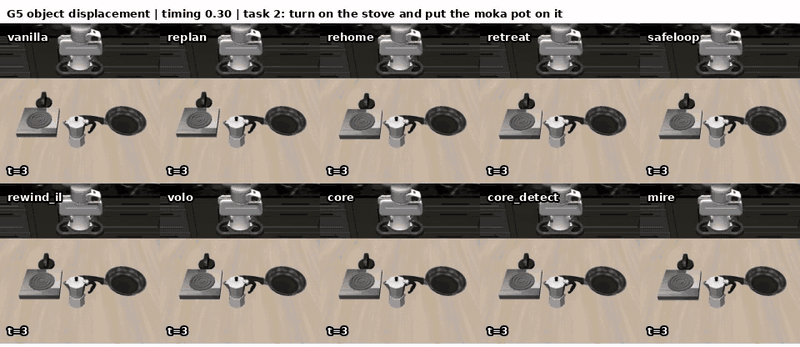</a>

| vanilla | replan | rehome | retreat | safeloop | rewind_il | volo | core | core_detect | mire |
|---|---|---|---|---|---|---|---|---|---|
| ✗ no intervention | ✗ no intervention | ✗ policy failed after recovery | ✗ policy failed after recovery | ✗ policy failed after recovery | ✗ recovery infeasible | ✗ recovery infeasible | ✗ recovery exec. failed | ✗ policy failed after recovery | ✓ success t=291 |

**G5 object displacement, task 5**: pick up the book and place it in the back compartment of the caddy (timing 0.75, initial state 6, seed 6)

<a href="assets/qualitative/libero_10_oft/results/mire_only/object_displace_0.75_task5_init6_seed6.mp4">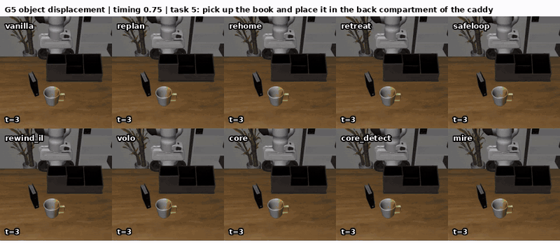</a>

| vanilla | replan | rehome | retreat | safeloop | rewind_il | volo | core | core_detect | mire |
|---|---|---|---|---|---|---|---|---|---|
| ✗ no intervention | ✗ no intervention | ✗ policy failed after recovery | ✗ policy failed after recovery | ✗ policy failed after recovery | ✗ recovery infeasible | ✗ policy failed after recovery | ✗ policy failed after recovery | ✗ no intervention | ✓ success t=530 |

**G5 object displacement, task 6**: put the white mug on the plate and put the chocolate pudding to the right of the plate (timing 0.75, initial state 9, seed 9)

<a href="assets/qualitative/libero_10_oft/results/mire_only/object_displace_0.75_task6_init9_seed9.mp4">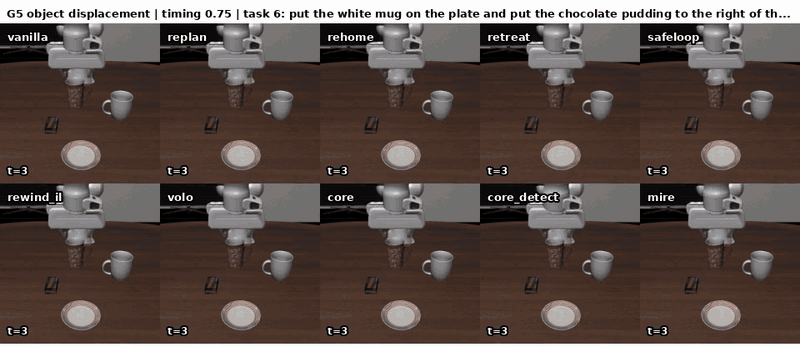</a>

| vanilla | replan | rehome | retreat | safeloop | rewind_il | volo | core | core_detect | mire |
|---|---|---|---|---|---|---|---|---|---|
| ✗ no intervention | ✗ no intervention | ✗ policy failed after recovery | ✗ policy failed after recovery | ✗ policy failed after recovery | ✗ recovery infeasible | ✗ policy failed after recovery | ✗ policy failed after recovery | ✗ policy failed after recovery | ✓ success t=281 |

**G5 object displacement, task 8**: put both moka pots on the stove (timing 0.30, initial state 7, seed 7)

<a href="assets/qualitative/libero_10_oft/results/mire_only/object_displace_0.30_task8_init7_seed7.mp4">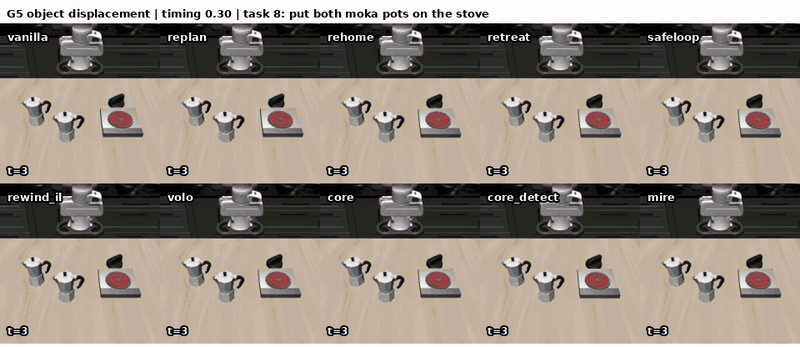</a>

| vanilla | replan | rehome | retreat | safeloop | rewind_il | volo | core | core_detect | mire |
|---|---|---|---|---|---|---|---|---|---|
| ✗ no intervention | ✗ no intervention | ✗ policy failed after recovery | ✗ policy failed after recovery | ✗ policy failed after recovery | ✗ recovery infeasible | ✗ policy failed after recovery | ✗ recovery exec. failed | ✗ no intervention | ✓ success t=522 |

**G5 object displacement, task 9**: put the yellow and white mug in the microwave and close it (timing 0.55, initial state 6, seed 6)

<a href="assets/qualitative/libero_10_oft/results/mire_only/object_displace_0.55_task9_init6_seed6.mp4">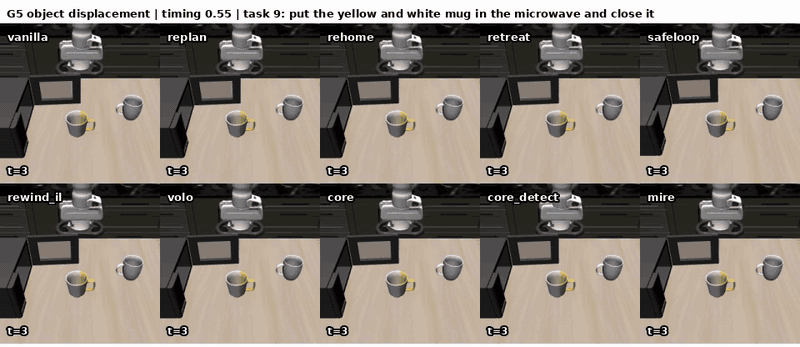</a>

| vanilla | replan | rehome | retreat | safeloop | rewind_il | volo | core | core_detect | mire |
|---|---|---|---|---|---|---|---|---|---|
| ✗ no intervention | ✗ no intervention | ✗ policy failed after recovery | ✗ policy failed after recovery | ✗ policy failed after recovery | ✗ recovery infeasible | ✗ policy failed after recovery | ✗ policy failed after recovery | ✗ recovery infeasible | ✓ success t=283 |

**G4 object tip-over, task 7**: put both the alphabet soup and the cream cheese box in the basket (timing 0.55, initial state 9, seed 9)

<a href="assets/qualitative/libero_10_oft/results/mire_only/object_tip_0.55_task7_init9_seed9.mp4">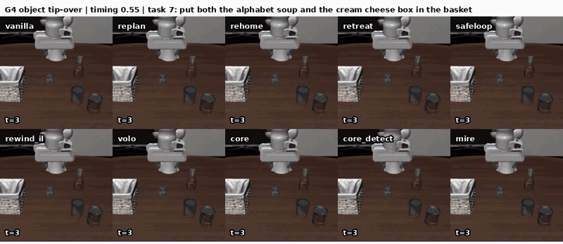</a>

| vanilla | replan | rehome | retreat | safeloop | rewind_il | volo | core | core_detect | mire |
|---|---|---|---|---|---|---|---|---|---|
| ✗ no intervention | ✗ no intervention | ✗ policy failed after recovery | ✗ policy failed after recovery | ✗ policy failed after recovery | ✗ recovery infeasible | ✗ recovery exec. failed | ✗ recovery infeasible | ✗ no intervention | ✓ success t=442 |

**G4 object tip-over, task 8**: put both moka pots on the stove (timing 0.75, initial state 10, seed 10)

<a href="assets/qualitative/libero_10_oft/results/mire_only/object_tip_0.75_task8_init10_seed10.mp4">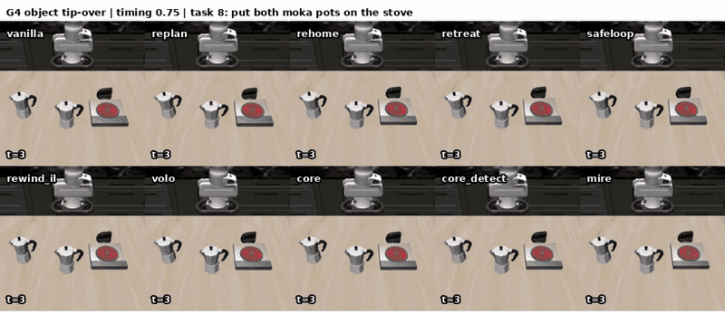</a>

| vanilla | replan | rehome | retreat | safeloop | rewind_il | volo | core | core_detect | mire |
|---|---|---|---|---|---|---|---|---|---|
| ✗ no intervention | ✗ no intervention | ✗ policy failed after recovery | ✗ policy failed after recovery | ✗ policy failed after recovery | ✗ recovery infeasible | ✗ policy failed after recovery | ✗ policy failed after recovery | ✗ recovery exec. failed | ✓ success t=580 |

**G4 object tip-over, task 2**: turn on the stove and put the moka pot on it (timing 0.30, initial state 6, seed 6)

<a href="assets/qualitative/libero_10_oft/results/mire_only/object_tip_0.30_task2_init6_seed6.mp4">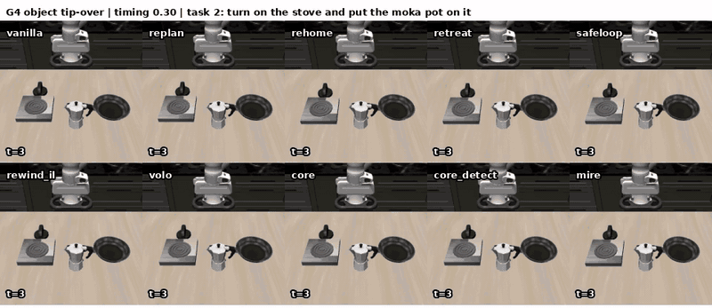</a>

| vanilla | replan | rehome | retreat | safeloop | rewind_il | volo | core | core_detect | mire |
|---|---|---|---|---|---|---|---|---|---|
| ✗ no intervention | ✗ no intervention | ✗ policy failed after recovery | ✗ policy failed after recovery | ✗ policy failed after recovery | ✗ recovery infeasible | ✗ policy failed after recovery | ✗ policy failed after recovery | ✗ policy failed after recovery | ✓ success t=305 |

**G4 object tip-over, task 0**: put both the alphabet soup and the tomato sauce in the basket (timing 0.75, initial state 1, seed 1)

<a href="assets/qualitative/libero_10_oft/results/mire_only/object_tip_0.75_task0_init1_seed1.mp4">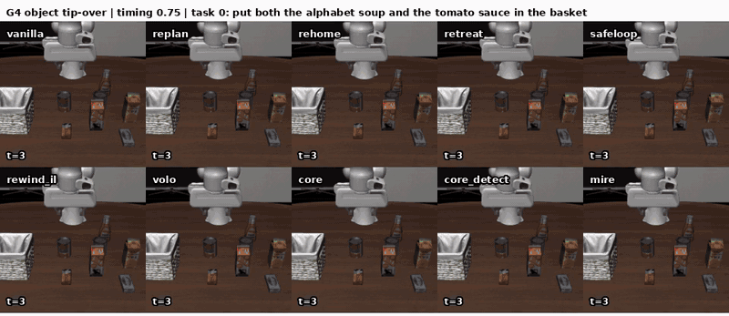</a>

| vanilla | replan | rehome | retreat | safeloop | rewind_il | volo | core | core_detect | mire |
|---|---|---|---|---|---|---|---|---|---|
| ✗ no intervention | ✗ no intervention | ✗ policy failed after recovery | ✗ policy failed after recovery | ✗ policy failed after recovery | ✗ recovery infeasible | ✗ policy failed after recovery | ✗ recovery infeasible | ✗ recovery infeasible | ✓ success t=364 |

**G4 object tip-over, task 6**: put the white mug on the plate and put the chocolate pudding to the right of the plate (timing 0.30, initial state 0, seed 0)

<a href="assets/qualitative/libero_10_oft/results/mire_only/object_tip_0.30_task6_init0_seed0.mp4">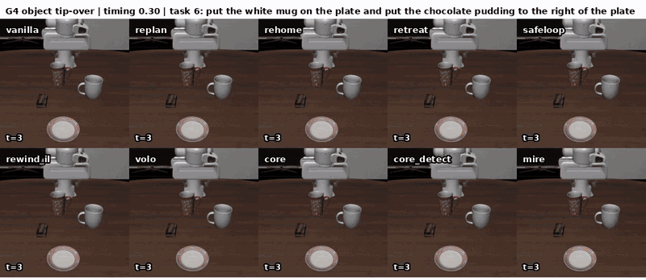</a>

| vanilla | replan | rehome | retreat | safeloop | rewind_il | volo | core | core_detect | mire |
|---|---|---|---|---|---|---|---|---|---|
| ✗ no intervention | ✗ no intervention | ✗ policy failed after recovery | ✗ policy failed after recovery | ✗ recovery infeasible | ✗ recovery infeasible | ✗ policy failed after recovery | ✗ policy failed after recovery | ✗ policy failed after recovery | ✓ success t=524 |
<!-- QUALITATIVE:nv10:mire_only END -->

### 2.2 Other methods also succeed, but mire does better

#### Faster success

<!-- QUALITATIVE:nv10:faster START -->
- core and mire both succeed in 615 paired episodes; mire finishes first in 430 (median lead 125 steps).

**R1 arm collision, task 4**: put the white mug on the left plate and put the yellow and white mug on the right plate (timing 0.30, initial state 9, seed 9)

<a href="assets/qualitative/libero_10_oft/results/faster/arm_collision_0.30_task4_init9_seed9.mp4">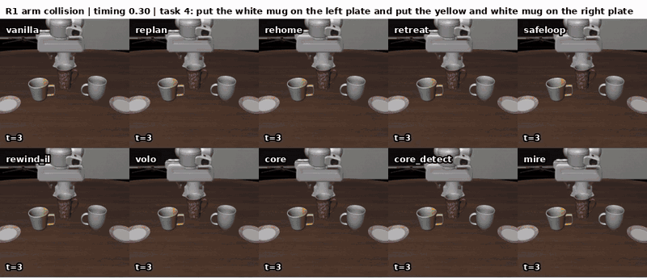</a>

| vanilla | replan | rehome | retreat | safeloop | rewind_il | volo | core | core_detect | mire |
|---|---|---|---|---|---|---|---|---|---|
| ✗ no intervention | ✗ no intervention | ✗ policy failed after recovery | ✗ policy failed after recovery | ✗ recovery infeasible | ✗ recovery infeasible | ✗ no intervention | ✓ success t=583 | ✗ no intervention | ✓ success t=312 |

**R1 arm collision, task 3**: put the black bowl in the bottom drawer of the cabinet and close it (timing 0.55, initial state 3, seed 3)

<a href="assets/qualitative/libero_10_oft/results/faster/arm_collision_0.55_task3_init3_seed3.mp4">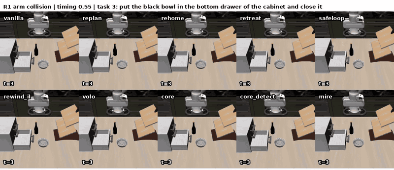</a>

| vanilla | replan | rehome | retreat | safeloop | rewind_il | volo | core | core_detect | mire |
|---|---|---|---|---|---|---|---|---|---|
| ✗ no intervention | ✗ no intervention | ✗ policy failed after recovery | ✗ policy failed after recovery | ✗ recovery infeasible | ✗ recovery infeasible | ✗ no intervention | ✓ success t=529 | ✓ success t=436 | ✓ success t=288 |

**R1 arm collision, task 5**: pick up the book and place it in the back compartment of the caddy (timing 0.75, initial state 6, seed 6)

<a href="assets/qualitative/libero_10_oft/results/faster/arm_collision_0.75_task5_init6_seed6.mp4">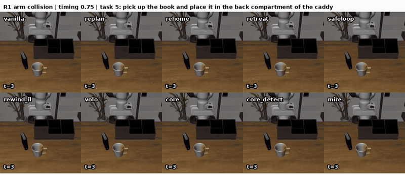</a>

| vanilla | replan | rehome | retreat | safeloop | rewind_il | volo | core | core_detect | mire |
|---|---|---|---|---|---|---|---|---|---|
| ✗ no intervention | ✗ no intervention | ✗ policy failed after recovery | ✗ policy failed after recovery | ✓ success t=450 | ✗ policy failed after recovery | ✗ no intervention | ✓ success t=491 | ✓ success t=590 | ✓ success t=233 |

**R1 arm collision, task 6**: put the white mug on the plate and put the chocolate pudding to the right of the plate (timing 0.30, initial state 1, seed 1)

<a href="assets/qualitative/libero_10_oft/results/faster/arm_collision_0.30_task6_init1_seed1.mp4">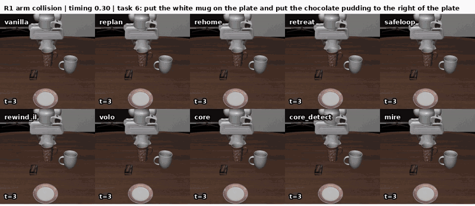</a>

| vanilla | replan | rehome | retreat | safeloop | rewind_il | volo | core | core_detect | mire |
|---|---|---|---|---|---|---|---|---|---|
| ✗ no intervention | ✗ no intervention | ✗ policy failed after recovery | ✗ policy failed after recovery | ✗ policy failed after recovery | ✗ recovery infeasible | ✗ no intervention | ✓ success t=545 | ✓ success t=529 | ✓ success t=284 |

**R1 arm collision, task 1**: put both the cream cheese box and the butter in the basket (timing 0.55, initial state 2, seed 2)

<a href="assets/qualitative/libero_10_oft/results/faster/arm_collision_0.55_task1_init2_seed2.mp4">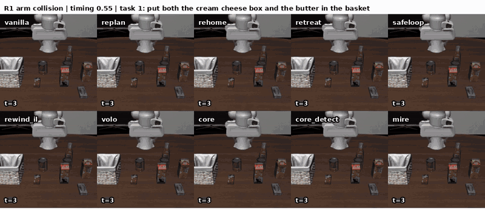</a>

| vanilla | replan | rehome | retreat | safeloop | rewind_il | volo | core | core_detect | mire |
|---|---|---|---|---|---|---|---|---|---|
| ✗ no intervention | ✗ no intervention | ✗ policy failed after recovery | ✗ policy failed after recovery | ✗ policy failed after recovery | ✗ recovery infeasible | ✓ success t=540 | ✓ success t=513 | ✓ success t=549 | ✓ success t=393 |

**T2 grasp failure, task 5**: pick up the book and place it in the back compartment of the caddy (timing 0.30, initial state 2, seed 2)

<a href="assets/qualitative/libero_10_oft/results/faster/grasp_failure_0.30_task5_init2_seed2.mp4">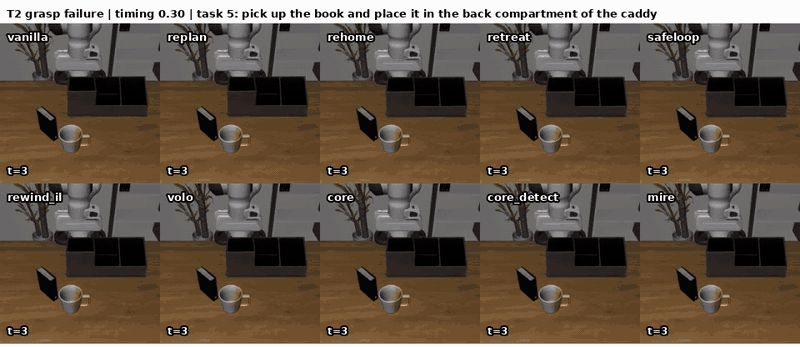</a>

| vanilla | replan | rehome | retreat | safeloop | rewind_il | volo | core | core_detect | mire |
|---|---|---|---|---|---|---|---|---|---|
| ✗ no intervention | ✗ no intervention | ✗ policy failed after recovery | ✗ policy failed after recovery | ✗ policy failed after recovery | ✗ recovery infeasible | ✗ policy failed after recovery | ✓ success t=548 | ✗ no intervention | ✓ success t=281 |

**T2 grasp failure, task 7**: put both the alphabet soup and the cream cheese box in the basket (timing 0.30, initial state 4, seed 4)

<a href="assets/qualitative/libero_10_oft/results/faster/grasp_failure_0.30_task7_init4_seed4.mp4">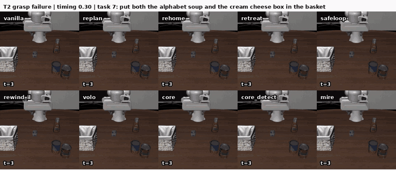</a>

| vanilla | replan | rehome | retreat | safeloop | rewind_il | volo | core | core_detect | mire |
|---|---|---|---|---|---|---|---|---|---|
| ✗ no intervention | ✗ no intervention | ✗ policy failed after recovery | ✗ policy failed after recovery | ✗ policy failed after recovery | ✗ recovery infeasible | ✗ policy failed after recovery | ✓ success t=544 | ✗ no intervention | ✓ success t=370 |

**T2 grasp failure, task 4**: put the white mug on the left plate and put the yellow and white mug on the right plate (timing 0.55, initial state 0, seed 0)

<a href="assets/qualitative/libero_10_oft/results/faster/grasp_failure_0.55_task4_init0_seed0.mp4">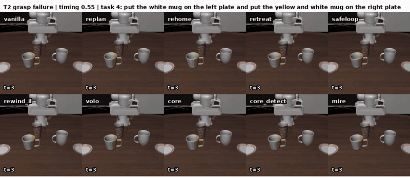</a>

| vanilla | replan | rehome | retreat | safeloop | rewind_il | volo | core | core_detect | mire |
|---|---|---|---|---|---|---|---|---|---|
| ✗ no intervention | ✗ no intervention | ✗ policy failed after recovery | ✗ policy failed after recovery | ✗ policy failed after recovery | ✗ recovery infeasible | ✗ policy failed after recovery | ✓ success t=564 | ✗ policy failed after recovery | ✓ success t=342 |

**T2 grasp failure, task 9**: put the yellow and white mug in the microwave and close it (timing 0.55, initial state 0, seed 0)

<a href="assets/qualitative/libero_10_oft/results/faster/grasp_failure_0.55_task9_init0_seed0.mp4">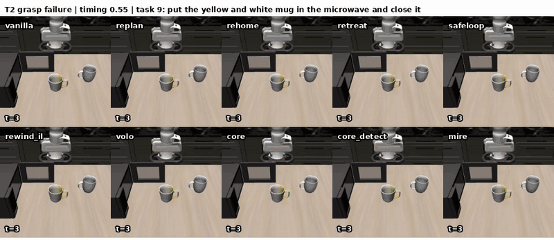</a>

| vanilla | replan | rehome | retreat | safeloop | rewind_il | volo | core | core_detect | mire |
|---|---|---|---|---|---|---|---|---|---|
| ✗ no intervention | ✗ no intervention | ✗ policy failed after recovery | ✗ policy failed after recovery | ✓ success t=565 | ✗ recovery infeasible | ✗ policy failed after recovery | ✓ success t=565 | ✓ success t=569 | ✓ success t=358 |

**T2 grasp failure, task 0**: put both the alphabet soup and the tomato sauce in the basket (timing 0.75, initial state 10, seed 10)

<a href="assets/qualitative/libero_10_oft/results/faster/grasp_failure_0.75_task0_init10_seed10.mp4">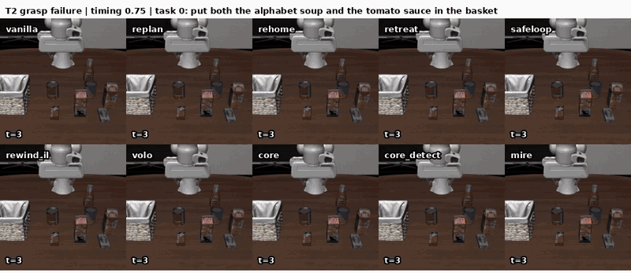</a>

| vanilla | replan | rehome | retreat | safeloop | rewind_il | volo | core | core_detect | mire |
|---|---|---|---|---|---|---|---|---|---|
| ✗ no intervention | ✗ no intervention | ✗ policy failed after recovery | ✗ policy failed after recovery | ✗ policy failed after recovery | ✗ recovery infeasible | ✗ policy failed after recovery | ✓ success t=588 | ✗ recovery exec. failed | ✓ success t=464 |

**G5 object displacement, task 0**: put both the alphabet soup and the tomato sauce in the basket (timing 0.55, initial state 0, seed 0)

<a href="assets/qualitative/libero_10_oft/results/faster/object_displace_0.55_task0_init0_seed0.mp4">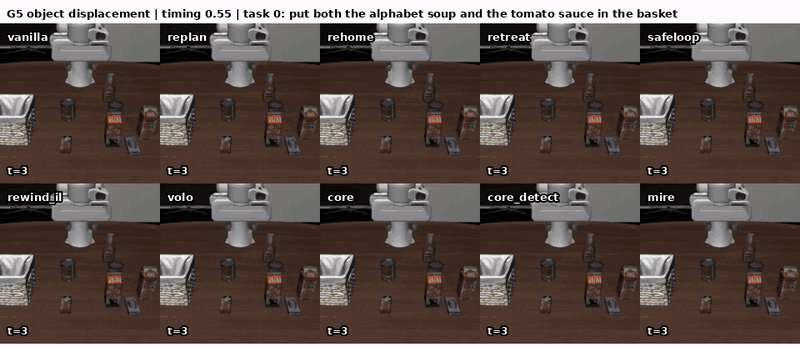</a>

| vanilla | replan | rehome | retreat | safeloop | rewind_il | volo | core | core_detect | mire |
|---|---|---|---|---|---|---|---|---|---|
| ✗ no intervention | ✗ no intervention | ✗ policy failed after recovery | ✗ policy failed after recovery | ✗ policy failed after recovery | ✗ recovery infeasible | ✗ policy failed after recovery | ✓ success t=584 | ✗ recovery infeasible | ✓ success t=295 |

**G5 object displacement, task 3**: put the black bowl in the bottom drawer of the cabinet and close it (timing 0.30, initial state 4, seed 4)

<a href="assets/qualitative/libero_10_oft/results/faster/object_displace_0.30_task3_init4_seed4.mp4">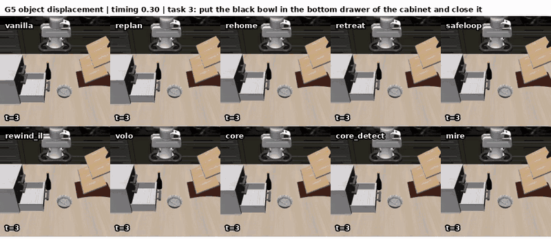</a>

| vanilla | replan | rehome | retreat | safeloop | rewind_il | volo | core | core_detect | mire |
|---|---|---|---|---|---|---|---|---|---|
| ✗ no intervention | ✓ success t=389 | ✗ policy failed after recovery | ✓ success t=350 | ✓ success t=311 | ✗ recovery infeasible | ✗ policy failed after recovery | ✓ success t=455 | ✓ success t=370 | ✓ success t=243 |

**G5 object displacement, task 9**: put the yellow and white mug in the microwave and close it (timing 0.75, initial state 5, seed 5)

<a href="assets/qualitative/libero_10_oft/results/faster/object_displace_0.75_task9_init5_seed5.mp4">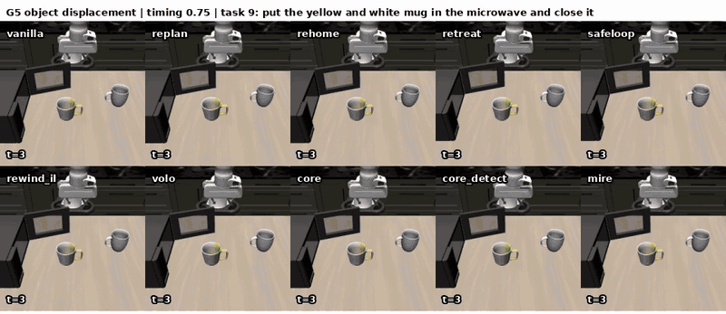</a>

| vanilla | replan | rehome | retreat | safeloop | rewind_il | volo | core | core_detect | mire |
|---|---|---|---|---|---|---|---|---|---|
| ✗ no intervention | ✗ no intervention | ✗ policy failed after recovery | ✗ policy failed after recovery | ✗ policy failed after recovery | ✗ recovery infeasible | ✗ policy failed after recovery | ✓ success t=580 | ✗ recovery exec. failed | ✓ success t=312 |

**G5 object displacement, task 2**: turn on the stove and put the moka pot on it (timing 0.75, initial state 2, seed 2)

<a href="assets/qualitative/libero_10_oft/results/faster/object_displace_0.75_task2_init2_seed2.mp4">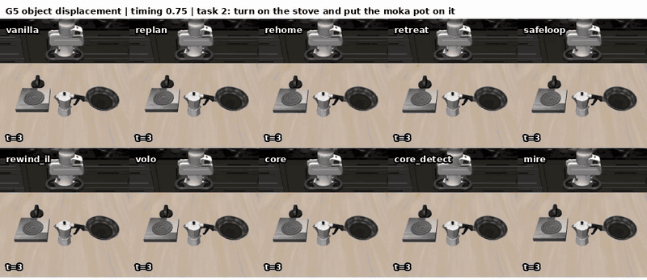</a>

| vanilla | replan | rehome | retreat | safeloop | rewind_il | volo | core | core_detect | mire |
|---|---|---|---|---|---|---|---|---|---|
| ✗ no intervention | ✗ no intervention | ✗ policy failed after recovery | ✗ policy failed after recovery | ✗ recovery exec. failed | ✗ recovery exec. failed | ✗ policy failed after recovery | ✓ success t=495 | ✓ success t=512 | ✓ success t=272 |

**G5 object displacement, task 5**: pick up the book and place it in the back compartment of the caddy (timing 0.30, initial state 7, seed 7)

<a href="assets/qualitative/libero_10_oft/results/faster/object_displace_0.30_task5_init7_seed7.mp4">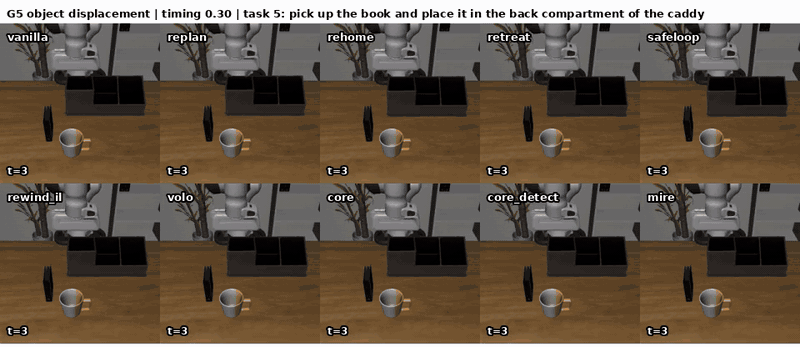</a>

| vanilla | replan | rehome | retreat | safeloop | rewind_il | volo | core | core_detect | mire |
|---|---|---|---|---|---|---|---|---|---|
| ✗ no intervention | ✗ no intervention | ✗ policy failed after recovery | ✗ policy failed after recovery | ✗ recovery infeasible | ✗ recovery infeasible | ✓ success t=314 | ✓ success t=394 | ✓ success t=480 | ✓ success t=216 |

**G4 object tip-over, task 2**: turn on the stove and put the moka pot on it (timing 0.55, initial state 2, seed 2)

<a href="assets/qualitative/libero_10_oft/results/faster/object_tip_0.55_task2_init2_seed2.mp4">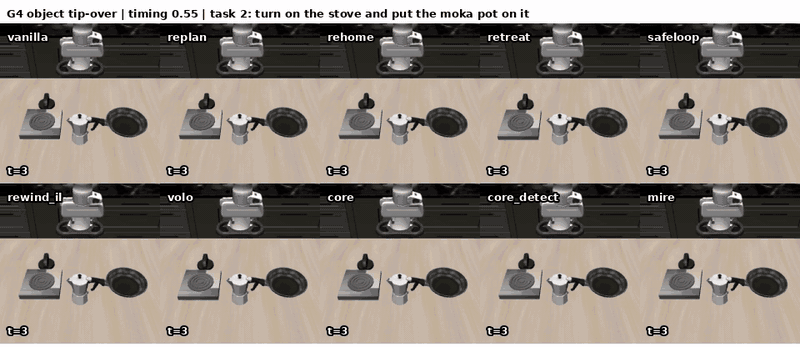</a>

| vanilla | replan | rehome | retreat | safeloop | rewind_il | volo | core | core_detect | mire |
|---|---|---|---|---|---|---|---|---|---|
| ✗ no intervention | ✗ no intervention | ✗ policy failed after recovery | ✗ policy failed after recovery | ✗ policy failed after recovery | ✗ recovery infeasible | ✗ recovery infeasible | ✓ success t=472 | ✗ policy failed after recovery | ✓ success t=296 |

**G4 object tip-over, task 6**: put the white mug on the plate and put the chocolate pudding to the right of the plate (timing 0.30, initial state 6, seed 6)

<a href="assets/qualitative/libero_10_oft/results/faster/object_tip_0.30_task6_init6_seed6.mp4">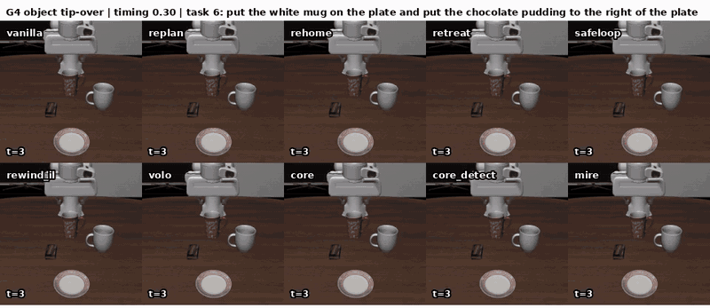</a>

| vanilla | replan | rehome | retreat | safeloop | rewind_il | volo | core | core_detect | mire |
|---|---|---|---|---|---|---|---|---|---|
| ✗ no intervention | ✗ no intervention | ✗ policy failed after recovery | ✗ policy failed after recovery | ✗ recovery infeasible | ✗ recovery infeasible | ✗ policy failed after recovery | ✓ success t=478 | ✗ policy failed after recovery | ✓ success t=359 |

**G4 object tip-over, task 7**: put both the alphabet soup and the cream cheese box in the basket (timing 0.55, initial state 8, seed 8)

<a href="assets/qualitative/libero_10_oft/results/faster/object_tip_0.55_task7_init8_seed8.mp4">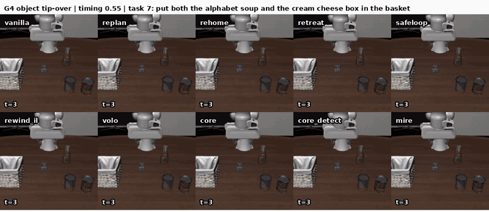</a>

| vanilla | replan | rehome | retreat | safeloop | rewind_il | volo | core | core_detect | mire |
|---|---|---|---|---|---|---|---|---|---|
| ✗ no intervention | ✗ no intervention | ✗ policy failed after recovery | ✗ policy failed after recovery | ✗ policy failed after recovery | ✗ recovery infeasible | ✓ success t=495 | ✓ success t=568 | ✗ recovery exec. failed | ✓ success t=395 |

**G4 object tip-over, task 6**: put the white mug on the plate and put the chocolate pudding to the right of the plate (timing 0.75, initial state 6, seed 6)

<a href="assets/qualitative/libero_10_oft/results/faster/object_tip_0.75_task6_init6_seed6.mp4">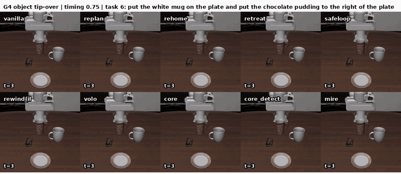</a>

| vanilla | replan | rehome | retreat | safeloop | rewind_il | volo | core | core_detect | mire |
|---|---|---|---|---|---|---|---|---|---|
| ✗ no intervention | ✗ no intervention | ✗ policy failed after recovery | ✗ policy failed after recovery | ✗ policy failed after recovery | ✗ recovery infeasible | ✗ policy failed after recovery | ✓ success t=504 | ✓ success t=583 | ✓ success t=386 |

**G4 object tip-over, task 4**: put the white mug on the left plate and put the yellow and white mug on the right plate (timing 0.75, initial state 0, seed 0)

<a href="assets/qualitative/libero_10_oft/results/faster/object_tip_0.75_task4_init0_seed0.mp4">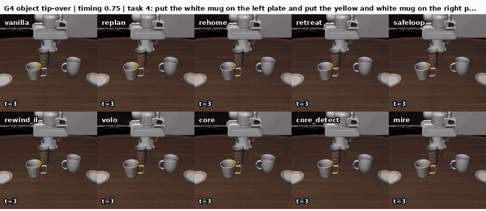</a>

| vanilla | replan | rehome | retreat | safeloop | rewind_il | volo | core | core_detect | mire |
|---|---|---|---|---|---|---|---|---|---|
| ✗ no intervention | ✗ no intervention | ✗ policy failed after recovery | ✗ policy failed after recovery | ✗ policy failed after recovery | ✗ recovery infeasible | ✗ policy failed after recovery | ✓ success t=484 | ✗ no intervention | ✓ success t=382 |
<!-- QUALITATIVE:nv10:faster END -->

#### Re-grasping: volo, core, mire

<!-- QUALITATIVE:nv10:regrasp START -->
- mire retakes the target with the policy's own grasp and succeeds while volo or core fails, and neither finishes more than 30 steps ahead of mire, in 392 paired episodes; mire sets the target down before retaking it in 64 of them.

**R1 arm collision, task 4**: put the white mug on the left plate and put the yellow and white mug on the right plate (timing 0.75, initial state 0, seed 0)

- `volo`: ✗ no intervention
- `core`: ✗ policy failed after recovery
- `mire`: ✓ success t=420 (route resume_grasp, set down and retaken with the own grasp, handed back goal pose unreachable after 212 steps)

**R1 arm collision, task 9**: put the yellow and white mug in the microwave and close it (timing 0.30, initial state 2, seed 2)

<a href="assets/qualitative/libero_10_oft/results/regrasp/arm_collision_0.30_task9_init2_seed2.mp4">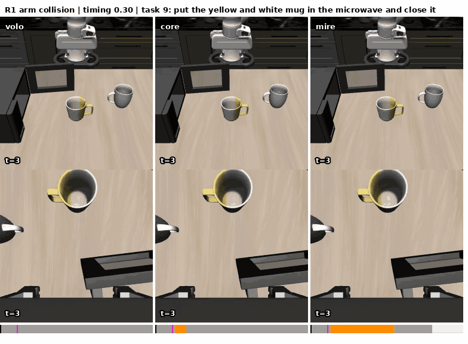</a>

- `volo`: ✗ no intervention
- `core`: ✗ policy failed after recovery
- `mire`: ✓ success t=476 (route resume_grasp, set down and retaken with the own grasp, handed back on agreement after 252 steps)

**R1 arm collision, task 1**: put both the cream cheese box and the butter in the basket (timing 0.55, initial state 7, seed 7)

<a href="assets/qualitative/libero_10_oft/results/regrasp/arm_collision_0.55_task1_init7_seed7.mp4">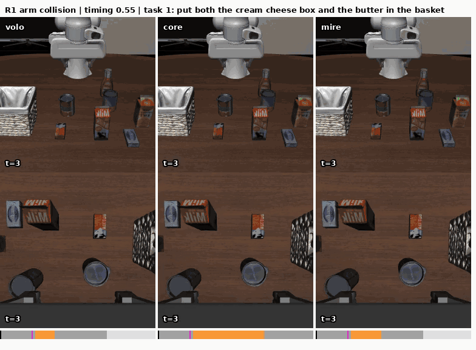</a>

- `volo`: ✓ success t=412 (grasped with a GraspGen grasp)
- `core`: ✗ policy failed after recovery (put the target back)
- `mire`: ✓ success t=414 (route grasp, own grasp, handed back 40 steps before the goal after 119 steps)

**R1 arm collision, task 5**: pick up the book and place it in the back compartment of the caddy (timing 0.30, initial state 0, seed 0)

<a href="assets/qualitative/libero_10_oft/results/regrasp/arm_collision_0.30_task5_init0_seed0.mp4">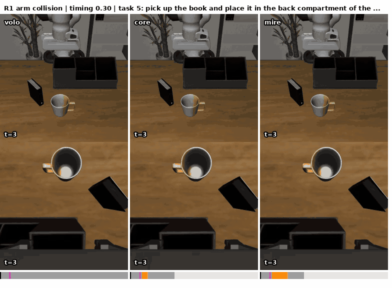</a>

- `volo`: ✗ no intervention
- `core`: ✓ success t=207
- `mire`: ✓ success t=206 (route resume_grasp, own grasp, handed back on agreement after 72 steps)

**R1 arm collision, task 2**: turn on the stove and put the moka pot on it (timing 0.75, initial state 8, seed 8)

<a href="assets/qualitative/libero_10_oft/results/regrasp/arm_collision_0.75_task2_init8_seed8.mp4">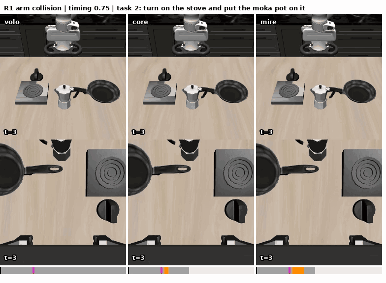</a>

- `volo`: ✗ no intervention
- `core`: ✓ success t=289
- `mire`: ✓ success t=280 (route resume_grasp, own grasp, handed back on agreement after 60 steps)

**T2 grasp failure, task 6**: put the white mug on the plate and put the chocolate pudding to the right of the plate (timing 0.75, initial state 9, seed 9)

- `volo`: ✗ policy failed after recovery (grasped with a GraspGen grasp)
- `core`: ✗ policy failed after recovery (put the target back)
- `mire`: ✓ success t=361 (route grasp, own grasp, handed back 40 steps before the goal after 95 steps)

**T2 grasp failure, task 0**: put both the alphabet soup and the tomato sauce in the basket (timing 0.55, initial state 5, seed 5)

<a href="assets/qualitative/libero_10_oft/results/regrasp/grasp_failure_0.55_task0_init5_seed5.mp4">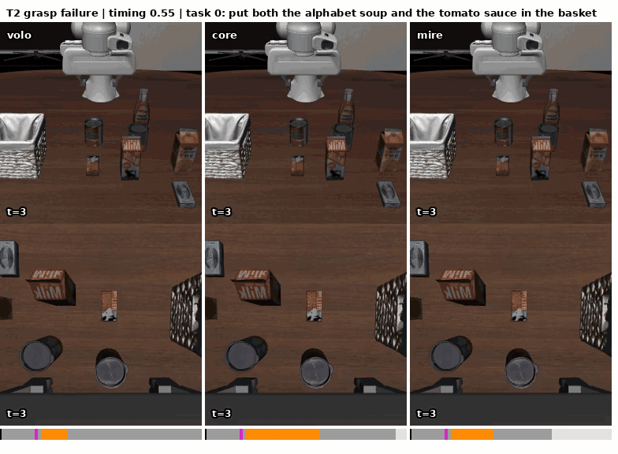</a>

- `volo`: ✗ policy failed after recovery (grasped with a GraspGen grasp)
- `core`: ✓ success t=567 (put the target back)
- `mire`: ✓ success t=420 (route grasp, own grasp, handed back 40 steps before the goal after 128 steps)

**T2 grasp failure, task 3**: put the black bowl in the bottom drawer of the cabinet and close it (timing 0.30, initial state 5, seed 5)

<a href="assets/qualitative/libero_10_oft/results/regrasp/grasp_failure_0.30_task3_init5_seed5.mp4">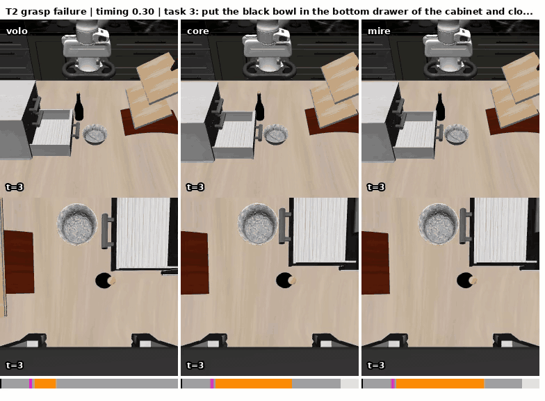</a>

- `volo`: ✗ policy failed after recovery (grasped with a GraspGen grasp)
- `core`: ✓ success t=537 (put the target back)
- `mire`: ✓ success t=541 (route grasp, set down and retaken with the own grasp, handed back on agreement after 296 steps)

**T2 grasp failure, task 9**: put the yellow and white mug in the microwave and close it (timing 0.55, initial state 9, seed 9)

<a href="assets/qualitative/libero_10_oft/results/regrasp/grasp_failure_0.55_task9_init9_seed9.mp4">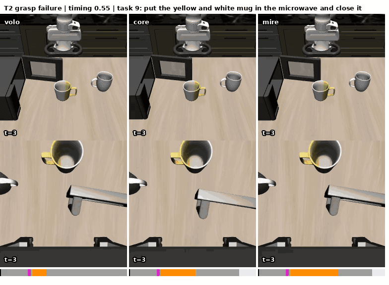</a>

- `volo`: ✗ policy failed after recovery (grasped with a GraspGen grasp)
- `core`: ✓ success t=518 (put the target back)
- `mire`: ✓ success t=538 (route grasp, set down and retaken with the own grasp, handed back on agreement after 228 steps)

**T2 grasp failure, task 7**: put both the alphabet soup and the cream cheese box in the basket (timing 0.75, initial state 8, seed 8)

<a href="assets/qualitative/libero_10_oft/results/regrasp/grasp_failure_0.75_task7_init8_seed8.mp4">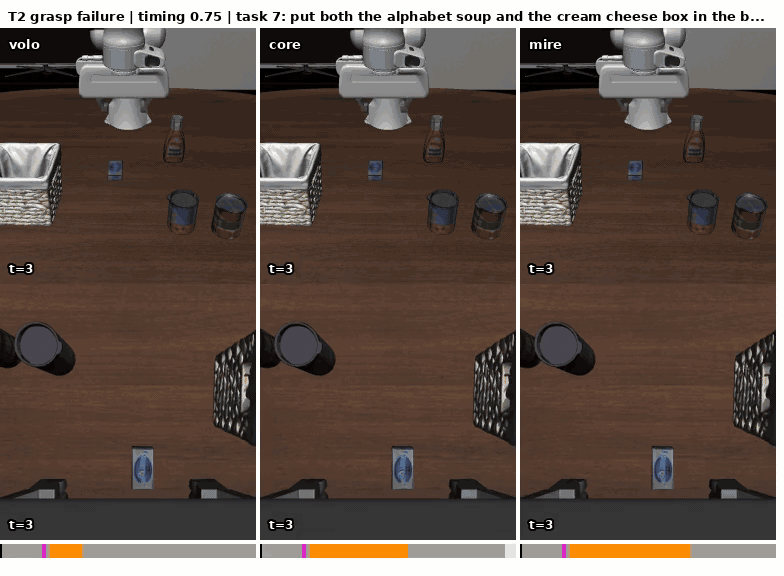</a>

- `volo`: ✗ policy failed after recovery (grasped with a GraspGen grasp)
- `core`: ✓ success t=574 (put the target back)
- `mire`: ✓ success t=599 (route grasp, set down and retaken with the own grasp, handed back on agreement after 284 steps)

**G5 object displacement, task 5**: pick up the book and place it in the back compartment of the caddy (timing 0.55, initial state 6, seed 6)

<a href="assets/qualitative/libero_10_oft/results/regrasp/object_displace_0.55_task5_init6_seed6.mp4">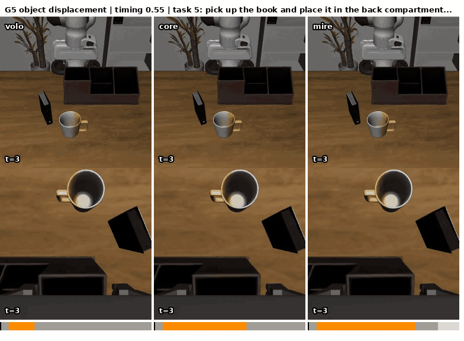</a>

- `volo`: ✗ policy failed after recovery (grasped with a GraspGen grasp)
- `core`: ✗ policy failed after recovery (put the target back)
- `mire`: ✓ success t=514 (route grasp, set down and retaken with the own grasp, handed back on agreement after 392 steps)

**G5 object displacement, task 0**: put both the alphabet soup and the tomato sauce in the basket (timing 0.30, initial state 1, seed 1)

- `volo`: ✗ policy failed after recovery (grasped with a GraspGen grasp)
- `core`: ✓ success t=462 (put the target back)
- `mire`: ✓ success t=444 (route grasp, set down and retaken with the own grasp, handed back on agreement after 232 steps)

**G5 object displacement, task 8**: put both moka pots on the stove (timing 0.30, initial state 3, seed 3)

- `volo`: ✗ policy failed after recovery (grasped with a GraspGen grasp)
- `core`: ✗ recovery exec. failed (target not restored)
- `mire`: ✓ success t=533 (route grasp, set down and retaken with the own grasp, handed back 40 steps before the goal after 270 steps)

**G5 object displacement, task 6**: put the white mug on the plate and put the chocolate pudding to the right of the plate (timing 0.75, initial state 1, seed 1)

- `volo`: ✗ policy failed after recovery (grasped with a GraspGen grasp)
- `core`: ✓ success t=460 (put the target back)
- `mire`: ✓ success t=458 (route grasp, set down and retaken with the own grasp, handed back on agreement after 256 steps)

**G5 object displacement, task 3**: put the black bowl in the bottom drawer of the cabinet and close it (timing 0.55, initial state 1, seed 1)

- `volo`: ✗ policy failed after recovery (grasped with a GraspGen grasp)
- `core`: ✓ success t=484 (put the target back)
- `mire`: ✓ success t=354 (route grasp, own grasp, handed back on agreement after 116 steps)

**G4 object tip-over, task 4**: put the white mug on the left plate and put the yellow and white mug on the right plate (timing 0.55, initial state 8, seed 8)

- `volo`: ✗ policy failed after recovery (grasped with a GraspGen grasp)
- `core`: ✗ policy failed after recovery (put the target back)
- `mire`: ✓ success t=581 (route grasp, set down and retaken with the own grasp, handed back 40 steps before the goal after 354 steps)

**G4 object tip-over, task 9**: put the yellow and white mug in the microwave and close it (timing 0.75, initial state 2, seed 2)

- `volo`: ✗ policy failed after recovery (grasped with a GraspGen grasp)
- `core`: ✓ success t=528 (put the target back)
- `mire`: ✓ success t=498 (route grasp, set down and retaken with the own grasp, handed back 40 steps before the goal after 280 steps)

**G4 object tip-over, task 7**: put both the alphabet soup and the cream cheese box in the basket (timing 0.30, initial state 4, seed 4)

- `volo`: ✗ policy failed after recovery (grasped with a GraspGen grasp)
- `core`: ✗ recovery infeasible (no grasp to put the target back: intervention request)
- `mire`: ✓ success t=576 (route grasp, set down and retaken with the own grasp, handed back 40 steps before the goal after 382 steps)

**G4 object tip-over, task 8**: put both moka pots on the stove (timing 0.30, initial state 0, seed 0)

- `volo`: ✗ policy failed after recovery (grasped with a GraspGen grasp)
- `core`: ✗ policy failed after recovery (put the target back)
- `mire`: ✓ success t=550 (route grasp, set down and retaken with the own grasp, handed back on agreement after 280 steps)

**G4 object tip-over, task 0**: put both the alphabet soup and the tomato sauce in the basket (timing 0.30, initial state 9, seed 9)

- `volo`: ✗ policy failed after recovery (grasped with a GraspGen grasp)
- `core`: ✗ recovery infeasible (no grasp to put the target back: intervention request)
- `mire`: ✓ success t=584 (route grasp, set down and retaken with the own grasp, handed back on agreement after 380 steps)
<!-- QUALITATIVE:nv10:regrasp END -->

### 2.3 Handoff by mire

<!-- QUALITATIVE:nv10:handoff START -->
- mire hands back on agreement in 456 of the 963 episodes it intervenes in.

**R1 arm collision, task 3**: put the black bowl in the bottom drawer of the cabinet and close it (timing 0.55, initial state 9, seed 9)

- `mire`: ✓ success t=292 (route carry, handed back on agreement after 64 steps)

**R1 arm collision, task 1**: put both the cream cheese box and the butter in the basket (timing 0.75, initial state 8, seed 8)

- `mire`: ✓ success t=289 (route resume_grasp, own grasp, handed back on agreement after 64 steps)

**R1 arm collision, task 9**: put the yellow and white mug in the microwave and close it (timing 0.75, initial state 6, seed 6)

- `mire`: ✓ success t=289 (route resume_follow, handed back on agreement after 64 steps)

**R1 arm collision, task 7**: put both the alphabet soup and the cream cheese box in the basket (timing 0.30, initial state 7, seed 7)

- `mire`: ✓ success t=305 (route carry, handed back on agreement after 64 steps)

**R1 arm collision, task 5**: pick up the book and place it in the back compartment of the caddy (timing 0.55, initial state 1, seed 1)

- `mire`: ✓ success t=226 (route carry, handed back on agreement after 60 steps)

**T2 grasp failure, task 6**: put the white mug on the plate and put the chocolate pudding to the right of the plate (timing 0.55, initial state 7, seed 7)

- `mire`: ✓ success t=332 (route grasp, own grasp, handed back on agreement after 96 steps)

**T2 grasp failure, task 0**: put both the alphabet soup and the tomato sauce in the basket (timing 0.75, initial state 3, seed 3)

- `mire`: ✓ success t=421 (route grasp, GraspGen grasp, handed back on agreement after 132 steps)

**T2 grasp failure, task 3**: put the black bowl in the bottom drawer of the cabinet and close it (timing 0.55, initial state 8, seed 8)

- `mire`: ✓ success t=314 (route grasp, own grasp, handed back on agreement after 60 steps)

**T2 grasp failure, task 5**: pick up the book and place it in the back compartment of the caddy (timing 0.30, initial state 5, seed 5)

- `mire`: ✓ success t=239 (route grasp, own grasp, handed back on agreement after 96 steps)

**T2 grasp failure, task 2**: turn on the stove and put the moka pot on it (timing 0.30, initial state 6, seed 6)

- `mire`: ✓ success t=295 (route carry, handed back on agreement after 28 steps)

**G5 object displacement, task 5**: pick up the book and place it in the back compartment of the caddy (timing 0.55, initial state 9, seed 9)

- `mire`: ✓ success t=196 (route grasp, own grasp, handed back on agreement after 104 steps)

**G5 object displacement, task 2**: turn on the stove and put the moka pot on it (timing 0.75, initial state 3, seed 3)

- `mire`: ✓ success t=279 (route grasp, own grasp, handed back on agreement after 104 steps)

**G5 object displacement, task 3**: put the black bowl in the bottom drawer of the cabinet and close it (timing 0.30, initial state 0, seed 0)

- `mire`: ✓ success t=264 (route grasp, own grasp, handed back on agreement after 104 steps)

**G5 object displacement, task 9**: put the yellow and white mug in the microwave and close it (timing 0.75, initial state 9, seed 9)

- `mire`: ✓ success t=321 (route grasp, own grasp, handed back on agreement after 100 steps)

**G5 object displacement, task 6**: put the white mug on the plate and put the chocolate pudding to the right of the plate (timing 0.55, initial state 0, seed 0)

- `mire`: ✓ success t=266 (route grasp, own grasp, handed back on agreement after 100 steps)

**G4 object tip-over, task 6**: put the white mug on the plate and put the chocolate pudding to the right of the plate (timing 0.55, initial state 6, seed 6)

- `mire`: ✓ success t=370 (route grasp, GraspGen grasp, handed back on agreement after 204 steps)

**G4 object tip-over, task 9**: put the yellow and white mug in the microwave and close it (timing 0.55, initial state 6, seed 6)

- `mire`: ✓ success t=478 (route grasp, set down and retaken with the own grasp, handed back on agreement after 276 steps)

**G4 object tip-over, task 0**: put both the alphabet soup and the tomato sauce in the basket (timing 0.75, initial state 2, seed 2)

- `mire`: ✓ success t=427 (route grasp, GraspGen grasp, handed back on agreement after 208 steps)

**G4 object tip-over, task 7**: put both the alphabet soup and the cream cheese box in the basket (timing 0.30, initial state 0, seed 0)

- `mire`: ✓ success t=390 (route grasp, GraspGen grasp, handed back on agreement after 192 steps)

**G4 object tip-over, task 1**: put both the cream cheese box and the butter in the basket (timing 0.75, initial state 1, seed 1)

- `mire`: ✓ success t=299 (route grasp, GraspGen grasp, handed back on agreement after 88 steps)
<!-- QUALITATIVE:nv10:handoff END -->

### 2.4 Limitations

<!-- QUALITATIVE:nv10:limits START -->
- mire fails in 289 paired episodes: no intervention 41, recovery infeasible 94, recovery exec. failed 57, policy failed after recovery 97.

**R1 arm collision, task 6** (recovery exec. failed): put the white mug on the plate and put the chocolate pudding to the right of the plate (timing 0.55, initial state 4, seed 4)

- `mire`: ✗ recovery exec. failed (route grasp, set down and retaken with the own grasp, handed back grasp missed after 86 steps)

**R1 arm collision, task 2** (no intervention): turn on the stove and put the moka pot on it (timing 0.75, initial state 1, seed 1)

- `mire`: ✗ no intervention (route none:on_path)

**R1 arm collision, task 9** (policy failed after recovery): put the yellow and white mug in the microwave and close it (timing 0.30, initial state 7, seed 7)

- `mire`: ✗ policy failed after recovery (route resume_grasp, set down and retaken with the own grasp, handed back 40 steps before the goal after 366 steps)

**T2 grasp failure, task 1** (recovery infeasible): put both the cream cheese box and the butter in the basket (timing 0.55, initial state 3, seed 3)

- `mire`: ✗ recovery infeasible (route grasp:no_feasible_grasp)

**T2 grasp failure, task 3** (no intervention): put the black bowl in the bottom drawer of the cabinet and close it (timing 0.75, initial state 3, seed 3)

- `mire`: ✗ no intervention (route none:goal_done)

**T2 grasp failure, task 8** (recovery exec. failed): put both moka pots on the stove (timing 0.30, initial state 4, seed 4)

- `mire`: ✗ recovery exec. failed (route grasp, set down and retaken with the own grasp, handed back grasp missed after 228 steps)

**G5 object displacement, task 0** (policy failed after recovery): put both the alphabet soup and the tomato sauce in the basket (timing 0.30, initial state 5, seed 5)

- `mire`: ✗ policy failed after recovery (route grasp, set down and retaken with the own grasp, handed back on agreement after 328 steps)

**G5 object displacement, task 8** (recovery exec. failed): put both moka pots on the stove (timing 0.55, initial state 6, seed 6)

- `mire`: ✗ recovery exec. failed (route grasp, GraspGen grasp, handed back goal pose unreachable after 75 steps)

**G5 object displacement, task 1** (recovery infeasible): put both the cream cheese box and the butter in the basket (timing 0.75, initial state 4, seed 4)

- `mire`: ✗ recovery infeasible (route grasp:no_feasible_grasp)

**G4 object tip-over, task 4** (no intervention): put the white mug on the left plate and put the yellow and white mug on the right plate (timing 0.30, initial state 6, seed 6)

- `mire`: ✗ no intervention (route grasp, set down and retaken with the own grasp)

**G4 object tip-over, task 5** (recovery infeasible): pick up the book and place it in the back compartment of the caddy (timing 0.75, initial state 4, seed 4)

- `mire`: ✗ recovery infeasible (route grasp:no_feasible_grasp)

**G4 object tip-over, task 7** (policy failed after recovery): put both the alphabet soup and the cream cheese box in the basket (timing 0.55, initial state 3, seed 3)

- `mire`: ✗ policy failed after recovery (route grasp, GraspGen grasp, handed back on agreement after 56 steps)
<!-- QUALITATIVE:nv10:limits END -->
